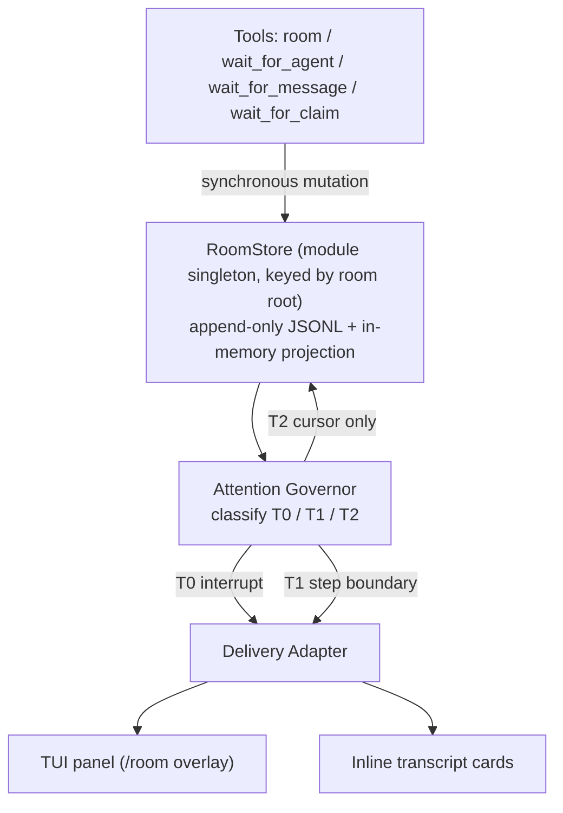

# Repository Guidelines

Research and design record for **`omp-agent-chatroom`** — an in-process coordination room for
[omp](https://omp.sh) that adds what native agent messaging lacks: **exclusive ownership of a named
resource with a lease**.

State: the plugin is **built**. `docs/research/omp-agent-chatroom/HANDOFF.md` is the current-state
entry point (gates, verified-live evidence, known limits); `PLAN-build.md` is the normative design
document. This file is the practical guide for working in the repo.

> **Authority order when documents disagree:** `plugin/src/**` > dated addenda in `PLAN-build.md` >
> plan body > `SCAFFOLD.md` > reviews > reports. `PLAN-build.md:60-62` declares its own body a
> historical record whose superseded prose was left untouched on purpose.

## Architecture & Data Flow

One omp plugin, loaded in-process as a TS module. Two halves: the plugin (`plugin/`) and the research
record that produced it (`docs/research/`).



`op:post` is the path everything hangs off: `tools/room.ts` appends synchronously, then
`notifyRecipients` runs `classify → isMuted → admitPost/selectT1 → deliver` per recipient.

**The store is authoritative**; the cold tree is a rebuildable cache over it. Cursors are per agent,
advanced on delivery into context, never on send.

## Key Directories

|Path|Purpose|
|---|---|
|`plugin/src/store/`|room root, log, projection, claim arbiter, cursors, config, tree, compactor|
|`plugin/src/attention/`|tier classification, governor, delivery adapter|
|`plugin/src/panel/`|three-pane overlay (chrome, keys, chat, board, roster)|
|`plugin/src/cards/`|quote-bordered body lines, message cards, tool cards|
|`plugin/src/tools/`|`room` and the three wait tools|
|`plugin/src/onboarding/`|digest, routing rule, `before_agent_start` hook|
|`plugin/src/commands/`|slash commands|
|`docs/research/omp-agent-chatroom/`|brief → REPORT → REPORT-v2 → PLAN-build → REPORT-v3 → build|
|`docs/research/omp-agent-notes/`|agent-facing notes on src / tests / config / docs|
|`docs/research/large-swarm-coordination/`|large-swarm research round: brief, REPORT, findings|
|`plans/`|numbered implementation plans (001–021) + index|
|`plugin/skills/omp-agent-chatroom/`|skill shipped with the plugin|

## Development Commands

```sh
cd plugin
bun test tests/                                 # whole suite (551 pass, 18 files)
bun check                                        # typecheck (Bun's own; ~10× faster than tsc)
bunx --bun tsc --noEmit -p tsconfig.json        # the same typecheck via tsc (CI runs this)
bunx --bun @biomejs/biome check src tests       # lint + format
bunx --bun @biomejs/biome check src tests --write   # apply fixes
```

**There is no build step** — Bun runs the TypeScript directly and omp loads it in-process. Two load
routes reach `plugin/src/index.ts`: the project shim `.omp/extensions/chatroom.ts` (what this repo
uses, auto-discovered) and `omp plugin link .` (packaged, verified with `omp plugin doctor`).

## Agent hygiene: scratch, cleanup, and how we verify

**Scratch goes in the ledger, never in a glob.** Every scratch dir or file you create is recorded
first, and cleanup deletes only recorded paths:

```sh
~/.omp/agent/scratch.sh new /tmp/<name>     # create it and record it
~/.omp/agent/scratch.sh clean --dry         # show what would go
~/.omp/agent/scratch.sh clean               # delete it, plus its omp session dir
```

- Never glob `/tmp` or the omp session store, and never `rm -rf` a path you did not create. A
  name pattern over a shared root is not an ownership check: `-tmp*` in
  `~/.omp/agent/sessions` matches the base `/tmp` session dir (`-tmp`) as well as the projects
  under it, and the base one belongs to the human.
- Off limits, always: `/tmp` itself, `~/.omp/agent/sessions`, `~/.omp/agent/sessions/-tmp`, and
  the human's own files. `trash` (recoverable) over `rm` for anything you created.
- The omp session dir for a scratch project is derived from the recorded path, so a recorded
  project under `/tmp/` can only ever map to a `-tmp-<project>` slug — never the base one.

**Verification: the test suite is the oracle, the human does the live runs.** Do not spawn omp
processes to probe the plugin — no `--mode json`/`text` runs, no pty harnesses, no live room-tool
probes, no scratch trees of fake session stores. `bun test tests/` plus `bun check` is what you
gate on. When a behaviour can only be seen in a real terminal or a real model, write it down as
**needs the human's live check** (in the handoff, with the exact steps) instead of probing it
yourself. The human has the machine and will run it.

## Code Conventions & Common Patterns

**Runtime is Bun. Never Node, npm, or npx.** There is no root `package.json` and no workspace.

**Invariants that must hold when editing** (I1–I13):

|#|Rule|Enforced at|
|---|---|---|
|I1|mutations are synchronous — no `await` between mint, write, project, notify|`store/room-store.ts:149-168`|
|I2|no session-scoped module state; key by root/agent in `globalThis` maps|`store/room-store.ts:60-67`, `store/compactor.ts:43`, `store/compactor.ts:111`, `store/tree-store.ts:133`|
|I3|key every shared structure by `ctx.agent.id`|`store/room-store.ts:243-250`, `panel/panel.ts:29`|
|I4|timers via `ctx.setInterval` only — never a raw timer (a throw is process-fatal)|`store/compactor.ts:303-317`, `store/room-store.ts:345-380`|
|I5|synchronous append survives a crash — `fsyncSync` in the one `appendLine` path|`store/log.ts:81-95`|
|I6|every wait promise settles — signal, timeout and promotion all `finish()`|`tools/wait-for-claim.ts:147-190` and both siblings|
|I7|the compactor's daily spend cap **and** its write mutex are per room root — never process-global, or a busy room starves the other|`store/compactor.ts:36-52`, `store/compactor.ts:106-122`|
|I8|delivery is serialised per room root — two concurrent posts reach a recipient in seq order|`tools/room.ts:357-376`|
|I9|a recipient's cursor never advances past a record it has not seen — the owed floor is applied to **every** cursor bump in `deliver()` (the T0/T1 path included, not only the T2 one)|`attention/delivery.ts:78-83`, `tools/room.ts:450-457`|
|I10|the load-time host-drift check **warns**, it never throws — a working room beats a plugin that refuses to load|`index.ts:31-47`|
|I11|a delivery never waits for the recipient's whole turn — the host's send resolves at the end of the **target's** turn, so every send is bounded (250 ms); a rejection inside the bound still surfaces as `deliveryError`, and the per-recipient deliveries run concurrently so one slow recipient cannot hold up the others|`attention/delivery.ts:25`, `attention/delivery.ts:38-63`, `attention/delivery.ts:145-153`, `tools/room.ts:333-337`|
|I12|a delivered T0 is delivered ONCE — while an older record is still owed the cursor cannot advance past it, so the T0 would be re-selected and re-sent (a wake+steer storm); the delivered T0s are remembered per room root and per recipient|`store/cursors.ts:32-72`, `attention/delivery.ts:144-158`, `tools/room.ts:449-456`|
|I13|the retention `gap` record is CARRIED by the next pass — it is T1 for every viewer but is appended outside any op's batch, so left uncarried it pinned every cursor and froze the room|`tools/room.ts:462-480`, `attention/tiers.ts:36`|

**The room lives in the global omp session store, not in the project tree.** The room root is
`getSessionsDir()/rooms/<16 hex chars of the project path>` — i.e. `~/.omp/agent/sessions/rooms/<hash>`
`($XDG_DATA_HOME/omp/sessions` under XDG) — so a room no longer lands in the user's working tree
(nothing is left in the working tree, so a checkout needs no `.omp-room/` ignore entry).
`roomRootFor()` is `store/room-root.ts:52-56`; `rootOf()` is `store/room-store.ts:229-235`.

Two rules, both deliberate:

- **A project under the system temp dir stays project-local** (`<cwd>/.omp-room`). A test, a
  scratch task or a throwaway worktree must never write into the user's real room store. A
  temp-dir project that is itself a git checkout may want its own `.omp-room/` ignore entry.
- **A legacy `<project>/.omp-room` is MOVED into the global store once**, on the first open of
  target root (`migrateLegacyRoom`, `store/room-root.ts`). The legacy `config.json` travels with
  the log, and the copied log is named after the id the TARGET resolves, so the pinned `roomId`
  survives the move; once the copy is verified, the legacy room is REMOVED — the copied files, the
  legacy `room/` directory and the empty legacy root — so the project tree ends up with no
  `.omp-room` at all. The copy takes BOTH locks: a legacy room held by a LIVE process belongs to
  that process and is left alone (no migration), and the target's lock keeps two omp processes from
  copying into the same room. A migration that is SKIPPED — the legacy room is held by a live omp
  process, the pinned room id matches no log, or the target already has a room — removes NOTHING and
  leaves the legacy room byte-for-byte intact.

The room is still ONE per project, shared by the main session and every subagent it spawns:
`ctx.cwd` is inherited by subagents and is the one stable per-tree key. `localProtocolOptions` is
per-session — a subagent's artifacts dir is its own session file minus `.jsonl`, so keying the room
there gave every agent a private room. The directory leaf is a hash of the *project path*, while
the room **id** is minted from the room *root*, so the two differ by design.

**One omp PROCESS per project.** The room has a single-writer lockfile (`<root>/room/.lock`, the
owner's pid, stale pids reaped). Subagents run *inside* the same process, so a whole swarm shares
one room and one lock — the lock is taken once per process per root. A SECOND omp process on the
same project (a second window, a cron-driven session) fails LOUDLY with `room file locked by pid
N` instead of silently minting colliding seqs: two writers were measured producing 10 duplicate
seqs over 40 records, and neither ever saw the other's records.

**Result contract (K1).** Every tool returns `content: [{type:"text", text}]` — always present; a
result without it is coerced to an error by the host — plus `details` with `ok`. The payload lives in
`details`, never as a bare object. Timeouts are **normal outcomes**:
`{ ok: true, outcome: "timeout", … }` with `useless: true` so compaction may elide them.
`outcome` ∈ `"event" | "timeout" | "aborted"`. Room failures are results, never throws.

**Escaping is load-bearing.** Every room-authored string that reaches the model goes through
`safeRoomText` (`onboarding/escape.ts`) — harness-tag neutralisation plus `sanitizeText`. The digest
rides `BeforeAgentStartEventResult.message` as a custom message, inside
`<room-authored untrusted="true">`. The system prompt carries only the static routing rule, so the
prompt-cache prefix is byte-stable.

**Tests are plain `bun:test` — no `mock.module`** (it leaks across files in one process). Fixtures
are real temp roots via `fs.mkdtempSync(path.join(os.tmpdir(), …))`; the fake LLM seam is
`registerCustomApi`. Fake ctx builders must set `cwd` to the temp root and complete the timer API.
Detailed conventions and the not-covered list: `docs/research/omp-agent-notes/tests.md`.

## Important Files

|File|Why|
|---|---|
|`plugin/src/index.ts`|the extension entry — calls every `registerX`|
|`plugin/src/version.ts`|`HOST_VERSION_PIN`; the drift gate and the load-time warning|
|`plugin/src/store/room-store.ts`|append, projection, refcounted registry, retention|
|`plugin/src/store/room-root.ts`|where the room lives: global session store, temp-dir exception, legacy migration|
|`plugin/src/store/log.ts`|the one append path, with `fsyncSync`|
|`plugin/src/store/tree-store.ts`|`cover`, `putNode`, `pending`/`ready`, `TREE_REC=512`|
|`plugin/src/store/compactor.ts`|background summarisation, rate cap, retry-with-ruler|
|`plugin/src/attention/tiers.ts` → `governor.ts` → `delivery.ts`|the attention pipeline|
|`plugin/src/panel/panel.ts`|the overlay; `resolveTheme` handles a host theme with no `fg`|
|`plugin/src/onboarding/routing-rule.md`|the shipped room-vs-`agent://` rule|
|`docs/research/omp-agent-chatroom/PLAN-build.md`|normative design; §4.1 ops, §5.2 caps, §10 risks|
|`docs/research/omp-agent-chatroom/HANDOFF.md`|current build state and verification evidence|

## Runtime/Tooling Preferences

- **Bun only** — `bun` 1.4.3. Package manager, runner, and runtime. No `node`, `npm`, or `npx`.
- **Host: omp 18.12.6.** The plugin pins it exactly in both `peerDependencies` and
  `devDependencies` — `@oh-my-pi/pi-coding-agent`, `@oh-my-pi/pi-tui`, `@oh-my-pi/pi-ai` and
  `@oh-my-pi/pi-utils` — because the ten deep subpath imports (`DEEP_SPECIFIERS`) are
  wildcard-only, not public API. The ten are
  `@oh-my-pi/pi-coding-agent/{internal-urls/local-protocol,registry/agent-registry,session/harness-tags,utils/event-bus}`
  and
  `@oh-my-pi/pi-tui/{chat/messages,chrome/overlay-box,render/render-utils,render/status-line,theme/active-symbols,tools/renderer}`
  — `theme/active-symbols` is the tenth (it is the host's own symbol lookup, which the plugin's
  theme shim resolves through rather than copying). Two of the ten are imported by the TESTS
  only (`pi-coding-agent/internal-urls/local-protocol` and `pi-coding-agent/utils/event-bus`): no
  source file imports them, but they are still subpaths the plugin resolves, so they belong in the
  list a host bump is audited against.
  `@oh-my-pi/pi-utils` was imported by eight source files while
  undeclared; it is now declared in both dependency blocks.
  `tests/drift.test.ts` asserts the installed host — and the global install, when one exists —
  equals `HOST_VERSION_PIN`, and ESM-imports the store-critical four of them;
  `tests/host-contract.test.ts` resolves every subpath the plugin imports (including
  `theme/active-symbols`) and asserts its named export, so a host bump that moves one fails
  there, naming the specifier, instead of at first use inside a panel. A load-time check in
  `src/index.ts` compares the host's own `VERSION` against the pin and **warns**; it never
  throws, because a room that still works beats a plugin that refuses to load.
  Whoever bumps the global omp must re-pin (`package.json` + `bun.lock` + `HOST_VERSION_PIN`) —
  the host moves fast and the drift gate only guards the pinned version.
- **No hot reload.** Extension factories bind once per session tree; source edits need a new session.
- **Python via `uv`**, never `python3`/`pip` (global agent rule).
- Biome config: `indentStyle: space`, `indentWidth: 2`, `lineWidth: 100`,
  `noNonNullAssertion` **off** (those assertions are deliberate, documented invariants),
  scope `src/**` + `tests/**`.

## Testing & QA

`bun:test`, no mocking. Run `cd plugin && bun test tests/`.

Test-only seams: `__roomTest.store.reset()` (`src/index.ts`), `__compactTest`
(`store/compactor.ts` — for the daily spend cap without 20 000 real calls), and
`AgentRegistry.resetGlobalForTests()` for the process-wide registry singleton. Reset store state in
`afterEach` for unit suites, and at the top of each test for the `createAgentSession` e2e suites.

**Assert the model-facing `content` array** for anything the model reads — `details` never reaches it.
A gap here hid a real defect once (see the K1 block in `tests/room-tool.test.ts`).

**Nothing is left unverified.** Every surface has been exercised by a real model in a real
terminal or a real session — the panel and its keys (including that an ended claim stays on the
board, dimmed, and that `r` releases exactly the selected claim and nothing in chat focus), the
inline cards, the claim board, the mention delivery, all three wait tools' `event` outcomes, the
legacy migration, the cold-tree summaries (faithful at the leaves, and a prompt injection inside a
room message was summarised as DATA, never obeyed), and the unprompted discovery rate (MEASURED at
75–86 %). The one thing that cannot be verified is live coordination across two omp *processes*: the
room's single-writer lock refuses the second writer by design, so that boundary is documented
rather than tested.

**Do not re-litigate these settled findings** — both are recorded with evidence:

- **Embeddings are deferred, not rejected**, with a stated revisit trigger (log past ~10⁵ records, or
  observed "cannot find it" failures). `docs/research/embeddings/CONCLUSION.md`. Count them as zero-match `room recall` results with `recallMiss:true` in details; watch miss rate over recalls on a non-empty log.
- **The UniiChat merge-age formula change was measured and rejected.** The spec's `first`→`last` fix
  looks authoritative (a reproducible counterexample plus a "481 of 20 001" match rate), but that
  figure describes its greedy most-due-pair loop, not our bisection. Measured on our procedure, the
  rejected change matches Taelin's `push` **worse** (8/400 vs 140/400).
  `docs/research/optmem-2026-10-08/A-merge-age-verification.md`.

## Room vs direct message — routing rule

**`agent://<id>`** when exactly ONE agent is the recipient, when the recipients must not see each
other's replies, when you are correcting or steering one running agent, or when broadcasting would
amplify an error.

**The room** (`room{op:"post"}`) when several agents must see the message AND each other's
responses, when it is a coordination artifact — a claim, a release, a shared finding, a status, an
async update — or when it is a question that wants cross-critique.

When in doubt, use the room.

A correction for a RUNNING agent goes to `agent://<id>`: a room mention is T0, so it does steer
that agent (at its next step boundary) — but it steers every agent the mention classifies, not just
the one you meant. The room is for shared context, not private redirection.

An interrupt *intent* is not an interrupt *strength*. A room **mention** is T0: it wakes an idle
agent and steers a streaming one, at its next step boundary. A plain room post (T1) is weaker — a
non-interrupting aside, so a running agent may keep working on the wrong thing until its next step
boundary. `agent://<id>` is the precise channel: one addressee, a bounded blast radius, no shared
record. Use it to correct one agent; use the room to tell several agents the same thing.

Before starting work that another agent might also start, claim it:
`room{op:"claim", topic, key, ttl}`. Release it when done: `room{op:"release", topic, key}`.
Never assume a claim you did not take. A claim you hold past its TTL is reclaimable, and the
reclaimer will be told — and so will you. Claiming a resource you already hold RENEWS your lease
(the TTL is a guess about how long your work takes), so renew rather than let it expire.

If you have nothing to do but wait for a peer, a claim, or a room message, BLOCK — do not poll:
`wait_for_agent`, `wait_for_message`, `wait_for_claim`. All are bounded and return an explicit
`outcome`.

The full procedure — the claim cycle, the wait/post/mention decision, the topic's status ledger —
is in the `omp-agent-chatroom` skill.