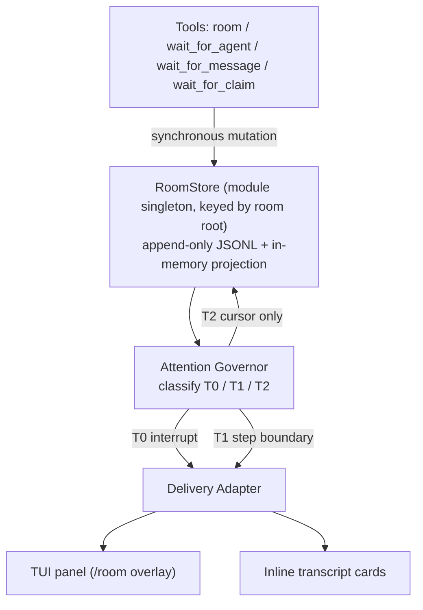

# Repository Guidelines

Research and design record for **`omp-agent-chatroom`** — an in-process coordination room for
[omp](https://omp.sh) that adds what native agent messaging lacks: **exclusive ownership of a named
resource with a lease**.

State: the plugin is **built**. `docs/research/omp-agent-chatroom/HANDOFF.md` is the current-state
entry point (gates, verified-live evidence, known limits); `PLAN-build.md` is the normative design
document. This file is the practical guide for working in the repo.

> **Authority order when documents disagree:** `plugin/src/**` > dated addenda in `PLAN-build.md` >
> plan body > `SCAFFOLD.md` > reviews > reports. `PLAN-build.md:60-62` declares its own body a
> historical record whose superseded prose was left untouched on purpose.

## Architecture & Data Flow

One omp plugin, loaded in-process as a TS module. Two halves: the plugin (`plugin/`) and the research
record that produced it (`docs/research/`).



`op:post` is the path everything hangs off: `tools/room.ts` appends synchronously, then
`notifyRecipients` runs `classify → isMuted → admitPost/selectT1 → deliver` per recipient.

**The store is authoritative**; the cold tree is a rebuildable cache over it. Cursors are per agent,
advanced on delivery into context, never on send.

## Key Directories

| Path | Purpose |
|---|---|
| `plugin/src/store/` | room root, log, projection, claim arbiter, cursors, config, tree, compactor |
| `plugin/src/attention/` | tier classification, governor, delivery adapter |
| `plugin/src/panel/` | three-pane overlay (chrome, keys, chat, board, roster) |
| `plugin/src/cards/` | quote-bordered body lines, message cards, tool cards |
| `plugin/src/tools/` | `room` and the three wait tools |
| `plugin/src/onboarding/` | digest, routing rule, `before_agent_start` hook |
| `plugin/src/commands/` | slash commands |
| `docs/research/omp-agent-chatroom/` | brief → REPORT → REPORT-v2 → PLAN-build → REPORT-v3 → build |
| `docs/research/omp-agent-notes/` | agent-facing notes on src / tests / config / docs |
| `docs/research/optmem-2026-10-08/` | OptMem/UniiChat revision 2026-10-08: four reports + rejection |

## Development Commands

```sh
cd plugin
bun test tests/                                 # the whole suite (274 pass, 15 files)
bunx --bun tsc --noEmit -p tsconfig.json        # typecheck only; Bun executes the TS
bunx --bun @biomejs/biome check src tests       # lint + format
bunx --bun @biomejs/biome check src tests --write   # apply fixes
```

**There is no build step** — Bun runs the TypeScript directly and omp loads it in-process. Two load
routes reach `plugin/src/index.ts`: the project shim `.omp/extensions/chatroom.ts` (what this repo
uses, auto-discovered) and `omp plugin link .` (packaged, verified with `omp plugin doctor`).

## Code Conventions & Common Patterns

**Runtime is Bun. Never Node, npm, or npx.** There is no root `package.json` and no workspace.

**Invariants that must hold when editing** (I1–I11):

| # | Rule | Enforced at |
|---|---|---|
| I1 | mutations are synchronous — no `await` between mint, write, project, notify | `store/room-store.ts:149-168` |
| I2 | no session-scoped module state; key by root/agent in `globalThis` maps | `store/room-store.ts:60-67`, `store/compactor.ts:43`, `store/compactor.ts:111`, `store/tree-store.ts:133` |
| I3 | key every shared structure by `ctx.agent.id` | `store/room-store.ts:243-250`, `panel/panel.ts:29` |
| I4 | timers via `ctx.setInterval` only — never a raw timer (a throw is process-fatal) | `store/compactor.ts:303-317`, `store/room-store.ts:345-380` |
| I5 | synchronous append survives a crash — `fsyncSync` in the one `appendLine` path | `store/log.ts:81-95` |
| I6 | every wait promise settles — signal, timeout and promotion all `finish()` | `tools/wait-for-claim.ts:147-190` and both siblings |
| I7 | the compactor's daily spend cap **and** its write mutex are per room root — never process-global, or a busy room starves the other | `store/compactor.ts:36-52`, `store/compactor.ts:106-122` |
| I8 | delivery is serialised per room root — two concurrent posts reach a recipient in seq order | `tools/room.ts:357-376` |
| I9 | a recipient's cursor never advances past a record it has not seen — the owed floor is applied to **every** cursor bump in `deliver()` (the T0/T1 path included, not only the T2 one) | `attention/delivery.ts:78-83`, `tools/room.ts:450-457` |
| I10 | the load-time host-drift check **warns**, it never throws — a working room beats a plugin that refuses to load | `index.ts:31-47` |
| I11 | a delivery never waits for the recipient's whole turn — the host's send resolves at the end of the **target's** turn, so every send is bounded (250 ms); a rejection inside the bound still surfaces as `deliveryError`, and the per-recipient deliveries run concurrently so one slow recipient cannot hold up the others | `attention/delivery.ts:25`, `attention/delivery.ts:38-63`, `attention/delivery.ts:145-153`, `tools/room.ts:333-337` |
| I12 | a delivered T0 is delivered ONCE — while an older record is still owed the cursor cannot advance past it, so the T0 would be re-selected and re-sent (a wake+steer storm); the delivered T0s are remembered per room root and per recipient | `store/cursors.ts:32-72`, `attention/delivery.ts:144-158`, `tools/room.ts:449-456` |
| I13 | the retention `gap` record is CARRIED by the next pass — it is T1 for every viewer but is appended outside any op's batch, so left uncarried it pinned every cursor and froze the room | `tools/room.ts:462-480`, `attention/tiers.ts:36` |

**The room lives in the global omp session store, not in the project tree.** The room root is
`getSessionsDir()/rooms/<16 hex chars of the project path>` — i.e. `~/.omp/agent/sessions/rooms/<hash>`
`($XDG_DATA_HOME/omp/sessions` under XDG) — so a room no longer lands in the user's working tree
(the `.omp-room/` gitignore entry stays only for a legacy or temp-dir room).
`roomRootFor()` is `store/room-root.ts:52-56`; `rootOf()` is `store/room-store.ts:229-235`.

Two rules, both deliberate:

- **A project under the system temp dir stays project-local** (`<cwd>/.omp-room`). A test, a
  scratch task or a throwaway worktree must never write into the user's real room store.
- **A legacy `<project>/.omp-room` is copied into the global store once**, on the first open of
  target root (`migrateLegacyRoom`, `store/room-root.ts`). The legacy `config.json` travels with
  the log, and the copied log is named after the id the TARGET resolves, so the pinned `roomId`
  survives the move; the old directory is left in place and is inert. The copy takes BOTH locks:
  a legacy room held by a LIVE process belongs to that process and is left alone (no migration),
  and the target's lock keeps two omp processes from copying into the same room.

The room is still ONE per project, shared by the main session and every subagent it spawns:
`ctx.cwd` is inherited by subagents and is the one stable per-tree key. `localProtocolOptions` is
per-session — a subagent's artifacts dir is its own session file minus `.jsonl`, so keying the room
there gave every agent a private room. The directory leaf is a hash of the *project path*, while
the room **id** is minted from the room *root*, so the two differ by design.

**One omp PROCESS per project.** The room has a single-writer lockfile (`<root>/room/.lock`, the
owner's pid, stale pids reaped). Subagents run *inside* the same process, so a whole swarm shares
one room and one lock — the lock is taken once per process per root. A SECOND omp process on the
same project (a second window, a cron-driven session) fails LOUDLY with `room file locked by pid
N` instead of silently minting colliding seqs: two writers were measured producing 10 duplicate
seqs over 40 records, and neither ever saw the other's records.

**Result contract (K1).** Every tool returns `content: [{type:"text", text}]` — always present; a
result without it is coerced to an error by the host — plus `details` with `ok`. The payload lives in
`details`, never as a bare object. Timeouts are **normal outcomes**:
`{ ok: true, outcome: "timeout", … }` with `useless: true` so compaction may elide them.
`outcome` ∈ `"event" | "timeout" | "aborted"`. Room failures are results, never throws.

**Escaping is load-bearing.** Every room-authored string that reaches the model goes through
`safeRoomText` (`onboarding/escape.ts`) — harness-tag neutralisation plus `sanitizeText`. The digest
rides `BeforeAgentStartEventResult.message` as a custom message, inside
`<room-authored untrusted="true">`. The system prompt carries only the static routing rule, so the
prompt-cache prefix is byte-stable.

**Tests are plain `bun:test` — no `mock.module`** (it leaks across files in one process). Fixtures
are real temp roots via `fs.mkdtempSync(path.join(os.tmpdir(), …))`; the fake LLM seam is
`registerCustomApi`. Fake ctx builders must set `cwd` to the temp root and complete the timer API.
Detailed conventions and the not-covered list: `docs/research/omp-agent-notes/tests.md`.

## Important Files

| File | Why |
|---|---|
| `plugin/src/index.ts` | the extension entry — calls every `registerX` |
| `plugin/src/version.ts` | `HOST_VERSION_PIN`; the drift gate and the load-time warning |
| `plugin/src/store/room-store.ts` | append, projection, refcounted registry, retention |
| `plugin/src/store/room-root.ts` | where the room lives: global session store, temp-dir exception, legacy migration |
| `plugin/src/store/log.ts` | the one append path, with `fsyncSync` |
| `plugin/src/store/tree-store.ts` | `cover`, `putNode`, `pending`/`ready`, `TREE_REC=512` |
| `plugin/src/store/compactor.ts` | background summarisation, rate cap, retry-with-ruler |
| `plugin/src/attention/tiers.ts` → `governor.ts` → `delivery.ts` | the attention pipeline |
| `plugin/src/panel/panel.ts` | the overlay; `resolveTheme` handles a host theme with no `fg` |
| `plugin/src/onboarding/routing-rule.md` | the shipped room-vs-`agent://` rule |
| `docs/research/omp-agent-chatroom/PLAN-build.md` | normative design; §4.1 ops, §5.2 caps, §10 risks |
| `docs/research/omp-agent-chatroom/HANDOFF.md` | current build state and verification evidence |

## Runtime/Tooling Preferences

- **Bun only** — `bun` 1.4.3. Package manager, runner, and runtime. No `node`, `npm`, or `npx`.
- **Host: omp 18.12.3.** The plugin pins it exactly in both `peerDependencies` and
  `devDependencies` — `@oh-my-pi/pi-coding-agent`, `@oh-my-pi/pi-tui`, `@oh-my-pi/pi-ai` and
  `@oh-my-pi/pi-utils` — because the nine deep subpath imports (`DEEP_SPECIFIERS`) are
  wildcard-only, not public API. `@oh-my-pi/pi-utils` was imported by eight source files while
  undeclared; it is now declared in both dependency blocks.
  `tests/drift.test.ts` asserts the installed host — and the global install, when one exists —
  equals `HOST_VERSION_PIN`, and ESM-imports every deep specifier. A load-time check in
  `src/index.ts` compares the host's own `VERSION` against the pin and **warns**; it never
  throws, because a room that still works beats a plugin that refuses to load.
  Whoever bumps the global omp must re-pin (`package.json` + `bun.lock` + `HOST_VERSION_PIN`) —
  the host moves fast and the drift gate only guards the pinned version.
- **No hot reload.** Extension factories bind once per session tree; source edits need a new session.
- **Python via `uv`**, never `python3`/`pip` (global agent rule).
- Biome config: `indentStyle: space`, `indentWidth: 2`, `lineWidth: 100`,
  `noNonNullAssertion` **off** (those assertions are deliberate, documented invariants),
  scope `src/**` + `tests/**`.

## Testing & QA

`bun:test`, no mocking. Run `cd plugin && bun test tests/`.

Test-only seams: `__roomTest.store.reset()` (`src/index.ts`), `__compactTest`
(`store/compactor.ts` — for the daily spend cap without 20 000 real calls), and
`AgentRegistry.resetGlobalForTests()` for the process-wide registry singleton. Reset store state in
`afterEach` for unit suites, and at the top of each test for the `createAgentSession` e2e suites.

**Assert the model-facing `content` array** for anything the model reads — `details` never reaches it.
A gap here hid a real defect once (see the K1 block in `tests/room-tool.test.ts`).

**Not covered, so treat as unverified:** real-model summarisation quality, and `wait_for_agent`'s
happy `event` path under a real model (`wait_for_message` and `wait_for_claim` were driven to their
`outcome: "event"` path by real models; `wait_for_agent`'s was not). Everything else was verified
live — the panel in a real terminal, the cards in a real transcript, the global room root, the
linked-plugin route, the legacy migration, the coordination checks — and the unprompted discovery
rate was MEASURED at 75–86 %. See "Live verification" below.

**Do not re-litigate these settled findings** — both are recorded with evidence:

- **Embeddings are deferred, not rejected**, with a stated revisit trigger (log past ~10⁵ records, or
  observed "cannot find it" failures). `docs/research/embeddings/CONCLUSION.md`.
- **The UniiChat merge-age formula change was measured and rejected.** The spec's `first`→`last` fix
  looks authoritative (a reproducible counterexample plus a "481 of 20 001" match rate), but that
  figure describes its greedy most-due-pair loop, not our bisection. Measured on our procedure, the
  rejected change matches Taelin's `push` **worse** (8/400 vs 140/400).
  `docs/research/optmem-2026-10-08/A-merge-age-verification.md`.

## Live Verification (omp 18.12.3)

The plugin was verified **live** against omp **18.12.3** — the exact version the plugin pins
(`omp --version` → `omp/18.12.3`; `plugin/package.json` peer + dev deps and `plugin/node_modules`
all 18.12.3). The packaged/linked route works: `omp plugin list` shows
`omp-agent-chatroom@0.1.0  Available: [room, wait-tools, panel]`, linked at
`~/.omp/plugins/node_modules/omp-agent-chatroom -> /home/yuzu/projects/omp-chatroom/plugin`.

The full set of checks below was run on **18.12.2**; the host then moved to 18.12.3 mid-round (the
drift gate caught it, and the pin moved with it), and the essential checks were re-run on
**18.12.3**: the room tool in a real model turn (`room join → rc1b11bca8146aa11 … cursor 0`,
`room post → t1 · seq 2`), the legacy migration keeping its room id (`room join →
rLEGACYFFFFGGGG`), and the `/room` panel opening and rendering (`Room #r9ee775e0aa4fd033 ·
chat|board · 1 running`, `no claims` in the board pane).

| Check | Live result |
|---|---|
| Plugin load | a fresh omp process loads the plugin with **zero stderr output** |
| `room` tool in a real model turn | `join` → `rb1665961b913ad8e · 0 claim(s) · 1 member(s) · cursor 0`; `board` → `0 claim(s), 1 member(s), 0 topic(s) / Main · running · lag 1`; a second run did `join` → `post` (`t1 · seq 2`) → `claim` (`t1/k1` → granted, expires in 300s) |
| Digest reaches the model | as a real custom message with `customType` `room:digest` |
| Global room root | room data lands in the **global** store at `<sessions>/rooms/<16 hex of the project path>/room/{config.json,<roomId>.jsonl}` (the leaf equals `sha256(projectPath).slice(0,16)`) and **never** in the project directory — the project tree stayed empty (no `.omp-room`) |
| XDG branch of `getSessionsDir()` | with `XDG_DATA_HOME` set **and** `$XDG_DATA_HOME/omp` existing, it resolves to `$XDG_DATA_HOME/omp/sessions`; without that app dir it falls back to `~/.omp/agent/sessions` |
| Legacy migration | a project-local `.omp-room/room/<id>.jsonl` + `config.json` was copied into the global room with the **same room id**, the legacy record preserved as seq 1, and the legacy directory left in place. A project genuinely under `os.tmpdir()` stays project-local and creates no global room |
| `/room` panel in a real terminal | **renders** — `tmux` is not installed on this machine, so a raw pty was used (python `pty.fork()` + `TIOCSWINSZ` 120x40, writing `/room` to the master fd). The panel showed the live room: the posted message in the chat pane, the held claim in the board pane, and the room id in the title matched the id in the global store file. The plugin's own panel trace shows `boxRound=object` (the field that used to crash it with `theme.boxRound` undefined) and `RoomPanel ctor: theme=object fg=function`, with no `FAILED` line and no `Room panel unavailable` notification |
| Noise | the plugin produced **no** errors, warnings or stack traces across all runs (the plugin's own stderr was empty; the only stderr was host-level noise — slow-startup notices and MCP server timeouts — and no matching entries in `~/.omp/logs/`) |
| Unprompted discovery | **measured over 16 trials**: the model claimed before mutating in 12 (85.7 % of scored trials, 75.0 % counting the two harness-error trials as misses). All three probe inputs (digest, routing rule, tool description) reached the model in 16/16; the control with the room plugin not loaded produced zero room calls. Every miss had the same shape: the model inspected the file and never consulted the room — and in a solo room the digest reads `1 live · 0 record(s)`, so the model correctly concluded there was nobody to coordinate with |
| Coordination under real models | claim arbitration (a second claim refused, naming the holder, one shared durable log), mention delivery (a subagent's `post` with `mention:[parent]` arrived as a real `[T0] room ⟵ …` steer), release freeing the resource, and `wait_for_message` / `wait_for_claim` returning `outcome: "event"` without hanging |
| The inline cards | **render in a real transcript** — `✉ room ⟵ Poster just now` + a quote-bordered body, and `▦ Room: join` / `▦ Room: post …` for the tool cards. The poster sees no message card for its own message (delivery suppresses self-authored records). `omp render` shows the RAW custom message instead: the render CLI builds its session without an `extensionRunner`, so the plugin's renderer never runs there — it is not a valid oracle |
| The process boundary | **cross-process coordination is COLD only**: the log, the board and the digest are shared (a later process replays the log), but LIVE coordination is in-process (delivery resolves targets through the local `AgentRegistry`), and a second live writer on one project directory is refused loudly (`room file locked by another session`). The coordination domain is one omp process with many agents |

**The check is not vacuous.** The same harness was run against a deliberately broken extension,
which produced `Failed to load extension ...: NEGATIVE-CONTROL deliberate extension failure` — so
the clean runs' silence is real signal, not a harness that cannot fail.

