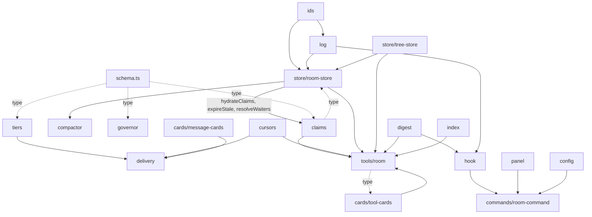

# SCAFFOLD.md — structural scaffold for `omp-agent-chatroom`

Date 2026-10-06 · Host omp **18.7.0** · Derived from `PLAN-build.md` (revised after round 3, snapshot `[D629]`).

**What this is.** Every file in `PLAN-build.md` §2.1 (plus the files the plan's prose requires but §2.1
omits), each with: exact path, exported symbols as **signatures only**, imports (module → symbols),
and a one-line purpose. No bodies. No algorithms. No conditionals. Where a body is unavoidable the
body is `throw new Error("not implemented")`.

**Closure contract.** Every import below resolves to an export defined in another section of this
document, or to a verified host export. §42 lists every symbol/type this scaffold had to invent.
§43 lists the round-3 findings and the fix applied to each.

**Round-3 conformance.** The scaffold implements the binding decisions in `review3/CONSOLIDATED.md`
K1–K22. Each place a decision changed a signature carries a `// K<n>` marker; §43.3 is the full
conformance table.

**Conventions.**

- `// §x.y` — the plan section that assigns the symbol.
- `// K<n>` — the round-3 binding decision the symbol implements.
- `// SCAFFOLD-DEFINED` — the plan uses the type but never defines it.
- `// [invented]` — the plan does not mention this symbol/file; the scaffold had to add it.
- Types are declared **once**. Every other file imports them. No redeclaration anywhere.
- Deep host imports are flagged `[deep]`; they resolve through the package `"./*"` wildcard export
  (RISK R2 / R22), never through a documented subpath.

### Host type map (all verified against the **installed 18.7.0** source — X6: the pre-round-4 label said 18.6.1)

| Symbol | Module | Verified at |
|---|---|---|
| `ExtensionAPI`, `ExtensionContext`, `ExtensionCommandContext`, `ExtensionFactory` | `@oh-my-pi/pi-coding-agent` | `extensibility/extensions/types.ts:1357,477,607,1780`; re-exported by `index.ts:25` |
| `ToolDefinition<TParams, TDetails>`, `ToolRenderResultOptions` | `@oh-my-pi/pi-coding-agent` | `extensibility/extensions/types.ts:664,638`; `execute` returns `Promise<AgentToolResult<TDetails>>` (`pi-agent-core/src/types.ts:993`) |
| `MessageRenderer`, `MessageRenderOptions` | `@oh-my-pi/pi-coding-agent` | re-exported `extensibility/extensions/types.ts:21-27` |
| `BeforeAgentStartEvent`, `BeforeAgentStartEventResult` | `@oh-my-pi/pi-coding-agent` | `types.ts:845,1295` |
| `AgentToolResult`, `AgentToolUpdateCallback` | `@oh-my-pi/pi-coding-agent` | re-exported `types.ts:142` |
| `AgentRegistry`, `AgentRef` | `@oh-my-pi/pi-coding-agent` | `sdk.ts:898` |
| `AgentStatus` | `@oh-my-pi/pi-coding-agent/registry/agent-registry` `[deep]` | `agent-registry.ts:18` |
| `resolveLocalRoot`, `resolveLocalUrlToPath`, `LocalProtocolOptions` | `@oh-my-pi/pi-coding-agent/internal-urls/local-protocol` `[deep]` | `local-protocol.ts:229,285,27` |
| `escapeHarnessTags` | `@oh-my-pi/pi-coding-agent/session/harness-tags` `[deep]` | `harness-tags.ts:14` |
| `sanitizeText`, `formatAge`, `withFileLockSync` | `@oh-my-pi/pi-utils` | `sanitize-text.ts:23`, `format.ts`, `file-lock.ts` |
| `streamSimple` | `@oh-my-pi/pi-ai` | `stream.ts:1307`, root-re-exported `index.ts:43` — **not** a deep import (K21) |
| `Model`, `Context`, `SimpleStreamOptions` | `@oh-my-pi/pi-ai` | `types.ts:1501,699` |
| `compact`, `elapsed`, `span`, `text` | `@oh-my-pi/pi-tui` | root-re-exported by `index.ts:62` → `native/describe.ts:85,112,21,26` (TSP builders) |
| `Component`, `TUI`, `Theme`, `theme`, `Stack`, `SplitPane`, `ScrollView`, `Editor`, `KeybindingsManager`, `Ellipsis`, `truncateToWidth`, `visibleWidth`, `replaceTabs`, `isFocusable`, `routeSgrMouseInput`, `OverlayOptions`, `OverlayHandle`, `KeyId`, `TableColumn`, `renderTableRow`, `LayoutRenderer` | `@oh-my-pi/pi-tui` | `index.ts:4-80`; `components/layout/geometry.ts`, `components/table.ts:72` |
| `PanelRows`, `topBorderSplit`, `dividerSplit`, `bottomBorder`, `row`, `OverlayPanel` | `@oh-my-pi/pi-tui/chrome/overlay-box` `[deep]` | `overlay-box.ts:69,89,41,47,123` |
| `createCachedComponent` | `@oh-my-pi/pi-tui/render/render-utils` `[deep]` | `render-utils.ts:1109` |
| `renderStatusLine` | `@oh-my-pi/pi-tui/render/status-line` `[deep]` | `status-line.ts:33` |
| `getEditorTheme`, `getMarkdownTheme`, `getSelectListTheme` | `@oh-my-pi/pi-tui/theme/tui-adapters` `[deep]` | `tui-adapters.ts:291,194,253` |
| `CustomMessage` | `@oh-my-pi/pi-tui/chat/messages` `[deep]` | `messages.ts:229` |
| `NativeToolView` | `@oh-my-pi/pi-tui/tools/renderer` `[deep]` | `tools/renderer.ts:98` |
| `statusGlyph`, `statusText`, `statusDot` | `@oh-my-pi/pi-tui/overlays/agent-hub-renderer` `[deep]` | `agent-hub-renderer.ts:64,98,82` |
| `EventBus` | `@oh-my-pi/pi-coding-agent/utils/event-bus` `[deep]` | `utils/event-bus.ts:3` |
| `createAgentSession`, `SessionManager` | `@oh-my-pi/pi-coding-agent` | `sdk.ts:1618`, `session/session-manager.ts:786` |
| `test`, `expect` | `bun:test` | Bun builtin |

**Note (X6).** This table was verified against the installed **18.7.0** tree
(`@oh-my-pi/pi-coding-agent` 18.7.0, `pi-tui` 18.7.0, `pi-ai` 18.7.0); the pre-round-4 label said
18.6.1 on every claim of the form "verified against …". The cited line numbers carry a consistent
+5..+10 drift from the numbers quoted in `PLAN-build.md` and the earlier reviews, but each still
resolves to the same declaration, so the evidence holds and only the label was wrong. The pin is
declared as a constant in `src/version.ts` (§44) and asserted by `tests/drift.test.ts` (§45).

---

## 1. `package.json`

**Purpose.** Plugin manifest; `omp` field is the `PluginManifest` (`extensibility/plugins/types.ts:26-49`).

```json
{
  "name": "omp-agent-chatroom",
  "version": "0.1.0",
  "description": "In-process multi-agent chatroom: claim board, bounded chat, blocking waits",
  "type": "module",
  "omp": {
    "name": "Agent Chatroom",
    "version": "0.1.0",
    "description": "In-process multi-agent chatroom: claim board, bounded chat, blocking waits",
    "extensions": ["./src/index.ts"],
    "features": {
      "room":       { "description": "Room store, claim board, and the room tool", "default": true, "extensions": ["./src/index.ts"] },
      "wait-tools": { "description": "Blocking wait tools", "default": true, "extensions": ["./src/index.ts"] },
      "panel":      { "description": "Interactive /room TUI panel", "default": true, "extensions": ["./src/index.ts"] }
    },
    "settings": { "…": "11 settings verbatim from PLAN §2.2" }
  },
  "engines": { "bun": ">=1.3.14" },
  "peerDependencies": {
    "@oh-my-pi/pi-coding-agent": "^18.7.0",
    "@oh-my-pi/pi-tui": "^18.7.0",
    "@oh-my-pi/pi-ai": "^18.7.0"
  },
  "scripts": {
    "typecheck": "tsc -p tsconfig.json",
    "test": "bun test"
  },
  "devDependencies": { "@types/bun": "^1.3.14", "typescript": "^5.9.0" }
}
```

**Imports.** none.
**Note (X6).** The host is **18.7.0**, not 18.6.1. `engines.bun` mirrors the host's own
(`>=1.3.14`, verified in the installed `@oh-my-pi/pi-coding-agent/package.json`) and
`peerDependencies` pin the three host packages to `^18.7.0`, which makes "verified against 18.7.0"
checkable rather than asserted. `src/version.ts` (§44) declares the same pin as a constant and
`tests/drift.test.ts` (§45) asserts the installed version against it.
**Note (R6).** `settings` is CLI-facing only and unreachable from extension code (§10 R6) — the plugin
owns `local://room/config.json` (§14). No `keybindings` field and no `skills` field exist in
`PluginManifest` (§2.2).
**Note (K6).** All three `features` entries point at `./src/index.ts`, so the manifest `features`
field gates only *which entry files load*; it does **not** gate runtime behaviour and nothing under
`src/` may read it. Runtime toggles use `registerFlag`/`getFlag` (§6, §14).

---

## 2. `tsconfig.json`

**Purpose.** Typecheck only; Bun runs TS directly.

```json
{
  "compilerOptions": {
    "target": "ESNext",
    "module": "Preserve",
    "moduleResolution": "bundler",
    "strict": true,
    "noEmit": true,
    "skipLibCheck": true,
    "types": ["bun"],
    "allowImportingTsExtensions": true,
    "allowArbitraryExtensions": true
  },
  "include": ["src", "tests"]
}
```

**Imports.** none.

---

## 3. `.gitignore`

**Purpose.** Keep build/test artifacts out of the repo.

```
node_modules/
dist/
*.log
.DS_Store
.room/
```

**Imports.** none.

---

## 4. `README.md`

**Purpose.** Human entry point; documents caps, routing rule, risks.

Content skeleton (headings only):

```markdown
# omp-agent-chatroom
## What it is            — room + claim board + 3 blocking wait tools
## Install               — `omp plugin link .` (§9 P7)
## The room tool         — op table (§4.1)
## Blocking waits        — wait_for_agent / wait_for_message / wait_for_claim (§4.2-4.4)
## Routing rule          — when to use `agent://` vs the room (§8)
## Caps                  — the §5.2 table verbatim
## Configuration         — local://room/config.json + /room config + --room-panel-key
## Risks & fallbacks     — the §10 table
```

**Imports.** none.

---

## 5. `src/env.d.ts` — `// [invented]` (not in §2.1)

**Purpose.** Ambient module declaration so `import rule from "./routing-rule.md" with { type: "text" }`
typechecks (§8 requires the text import).

```ts
declare module "*.md" {
  const text: string;
  export default text;
}
```

**Imports.** none.

---

## 6. `src/index.ts`

**Purpose.** Default-export `ExtensionFactory`; registers everything unconditionally (K6).

**Exports.**

```ts


export default function roomExtension(pi: ExtensionAPI): void {
  registerRoomFlags(pi);   // §14/K6 — the ONE registration site for --room-panel-key / --room-cold-tree
  throw new Error("not implemented");
}

/**
 * Test-only seam (§2.1.1 M-4). Clears the in-memory store between tests.
 */
export const __roomTest: { store: { reset(): void } } = {
  store: { reset(): void { resetRoomStores(); } },
};
```

**Imports.**

```ts
import type { ExtensionAPI } from "@oh-my-pi/pi-coding-agent";   // imported ONCE (D0)
import { registerRoomTool } from "./tools/room";
import { registerWaitForAgent } from "./tools/wait-for-agent";
import { registerWaitForMessage } from "./tools/wait-for-message";
import { registerWaitForClaim } from "./tools/wait-for-claim";
import { registerRoomCommand } from "./commands/room-command";
import { registerMessageRenderers } from "./cards/message-cards";
import { registerHooks } from "./onboarding/hook";
import { registerPanel } from "./panel/panel";
import { registerRoomFlags } from "./store/config";
import { resetRoomStores } from "./store/room-store";   // backs __roomTest
```

**Scaffold note (K6, applied).** There is **no runtime feature gate**. The factory reads no feature
set, because `ExtensionAPI` has none (`extensibility/extensions/types.ts:1357-1696`); the host's
feature state belongs to the plugin *loader* (`extensibility/plugins/types.ts:116`, consumed at
`plugins/loader.ts:377-395`) and only decides which entry files load. All three manifest `features`
point at `./src/index.ts`, so they gate nothing at runtime. Runtime toggles are CLI flags with
exactly one registration site:

```text
// [invented] names — K6. These calls live in the BODY of `registerRoomFlags(pi)` (§14), inside the
// factory, where `pi` is the factory parameter:
//   pi.registerFlag("room-panel-key", { type: "string", default: "" });     // §6.1, RISK R4
//   pi.registerFlag("room-cold-tree", { type: "boolean", default: true });  // §3.6 fallback switch
```

`resolveRoomConfig(pi, root)` (§14) reads them back with `pi.getFlag`.

`pi.registerFlag(...)` is called from `registerRoomFlags(pi)` (§14), which the factory body above
invokes. Both calls MUST live in the factory body — `pi` is a factory **parameter**, not a module
binding (D0: two `TS2304: Cannot find name 'pi'` errors came from the module-scope snippet that
used to sit here). The two flag names are documented in §14.


---

## 7. `src/ids.ts`

**Purpose.** Id + path derivation (§2.1.2 M-6).

**Exports.**

```ts
export function roomIdFor(root: string): string {                   // K7/X1 — ROOT-STABLE, never a session id
  throw new Error("not implemented");
}
export function logPathFor(root: string, roomId: string): string {  // K14 — the ONE log filename
  throw new Error("not implemented");
}
export function resourceKey(topic: string, key: string): string {   // "<topic>/<key>"
  throw new Error("not implemented");
}
export function newMessageId(): string {                            // UUID v4
  throw new Error("not implemented");
}
```

**Scaffold note (K7/X1, applied).** `roomIdFor` takes the **absolute `local://` root**, never a
session id. The earlier rule (`roomIdFor(sessionId)`) was design-breaking: each subagent is
constructed with its **own** `SessionManager` (`task/executor.ts:4181` `SessionManager.open(...)`,
`:4186` `SessionManager.inMemory(...)`) and `getSessionId()` returns that manager's own id
(`session-manager.ts:2989`, minted at `:129`), so the parent and every child resolved a **different**
`<root>/room/<id>.jsonl` — one room per agent, exactly the fragmentation the rule existed to
prevent, and §11.1's `expect(logPathA).toBe(logPathB)` was false by construction.

**Scaffold note (root stability, X1).** The rule is `"r" + sha256(root).slice(0, 16)`. The hash is
over the **whole absolute path**, never the tail: `resolveLocalRoot(opts)` returns
`path.resolve(artifactsDir, "local")` whenever an artifacts dir exists (`local-protocol.ts:229-240`),
so the last segment is *always* `"local"` and a tail-derived id would collapse every session tree in
every project onto the room id `"local"`. Hashing the root is deterministic, so every session on the
same root — including every subagent, which shares the parent root — resolves the same id with no
shared mutable state. An explicit override lives in `local://room/config.json` and is resolved by
`resolveRoomId(root)` (§14).

**Scaffold note (K14, applied).** `logPathFor(root, roomId)` is the single filename authority:
`<root>/room/<roomId>.jsonl`. §3.1, §3.3 and the §11.1 test all call it; no module re-derives the
name from a `local://` URL and no test hardcodes `room.jsonl`.

**Imports.**

```ts
import * as crypto from "node:crypto";
```

---

## 8. `src/store/schema.ts`

**Purpose.** The `RoomRecord` union and the shared protocol types (§3.2). Leaf: types only, no runtime
deps. (`MemberState` lives in `store/room-store.ts` — K11 — and `WaitOutcome` in
`tools/wait-for-claim.ts` — K11.)

**Exports.**

```ts
// §3.2 — verbatim
export type RoomRecord =
  | { v: 1; seq: number; ts: number; kind: "msg";     id: string; from: string; topic: string;
      body: string; to?: string; mention?: string[]; replyTo?: string; threadRoot?: string;
      performative?: Performative; replyWith?: string; replyBy?: string }
  | { v: 1; seq: number; ts: number; kind: "claim";   id: string; from: string; resource: string; ttlMs: number }
  | { v: 1; seq: number; ts: number; kind: "release"; id: string; from: string; resource: string;
      reason: "released" | "expired" | "reclaimed" | "aborted"; prevHolder: string }
  | { v: 1; seq: number; ts: number; kind: "note";    id: string; from: string; topic: string; body: string }
  | { v: 1; seq: number; ts: number; kind: "member";  id: string; from: string; action: "join" | "leave" }
  | { v: 1; seq: number; ts: number; kind: "gap";     id: string; from: string; skipped: number;
      reason: "retention" | "invalid" | "corrupt" };

export type Performative = "inform" | "request" | "propose" | "accept" | "reject" | "query" | "failure";

export type RecordKind = RoomRecord["kind"];

// §3.2 — the append input. The store mints v/seq/ts/id (§3.1 K15).
export type RoomRecordDraft =
  | Omit<Extract<RoomRecord, { kind: "msg" }>,     "v" | "seq" | "ts" | "id">
  | Omit<Extract<RoomRecord, { kind: "claim" }>,   "v" | "seq" | "ts" | "id">
  | Omit<Extract<RoomRecord, { kind: "release" }>, "v" | "seq" | "ts" | "id">
  | Omit<Extract<RoomRecord, { kind: "note" }>,    "v" | "seq" | "ts" | "id">
  | Omit<Extract<RoomRecord, { kind: "member" }>,  "v" | "seq" | "ts" | "id">
  | Omit<Extract<RoomRecord, { kind: "gap" }>,     "v" | "seq" | "ts" | "id">;

// K11 — WaitOutcome is declared ONCE, in tools/wait-for-claim.ts (§22), and imported here for the
// `details` payloads; no redeclaration.

// §4.1 "board return shape" — the literal shapes the plan gives, named (they live inside `details`).
export interface ClaimRow {
  resource: string; holder: string; ttlMs: number;
  expiresAt: number; acquiredAt: number; contended: number;
}
export interface RosterRow {
  agentId: string; status: string; cursor: number; lag: number; topics: string[];
}
export interface TopicRow { topic: string; lastSeq: number; unread: number }
export interface BoardResult {
  ok: true;
  claims: ClaimRow[];
  roster: RosterRow[];
  topics: TopicRow[];
}
```


**`release.prevHolder` (M11).** `from` on a `release` record is **the agent who released** — for a
reclaim that is the *new* claimant, not the agent who lost the lease. `prevHolder` is therefore
**required**, not optional: the arbiter/sweep that writes the record always knows the displaced
holder (`release()`/`reclaimIfStale()`/`expireStale()`, §10), and a plain release by the holder sets
`prevHolder === from`. The T0 eviction notice is classified on `record.prevHolder === viewer.agentId`
(§16) — classifying on `from` or on `reason` notifies the wrong agents, because `reason:"reclaimed"`
is a single record that cannot be targeted to one viewer.

**Imports.** none (leaf module — no runtime deps, no cycles).

---

## 9. `src/store/log.ts`

**Purpose.** Open / append / read / replay the JSONL log atomically (§3.3).

**Exports.**

```ts
// §2.1 §3.3 — K8: one fd per process per logPath, in a globalThis registry.
export function roomLogFd(root: string, roomId: string): number {   // mkdirSync + O_APPEND|O_CLOEXEC
  throw new Error("not implemented");
}
export function appendLine(fd: number, line: string): void {        // line MUST end "\n"
  throw new Error("not implemented");
}
export function readSince(fd: number, seq: number, limit: number): RoomRecord[] {
  throw new Error("not implemented");
}
export function replay(fd: number): { records: RoomRecord[]; skipped: number };   // §3.3
export function closeRoomLog(root: string, roomId: string): void {  // K8 — last live session only
  throw new Error("not implemented");
}

// S3 requires per-kind field validation on replay; §2.1 assigns it no file.
export function validateRecord(value: unknown): RoomRecord | null {       // [invented placement]
  throw new Error("not implemented");
}

// [invented] — §3.3's per-kind required-field table, as data (the validator's single source).
export const LOG_VALIDATION_FIELDS: Readonly<Record<RecordKind, readonly string[]>> = {
  msg:     ["v", "seq", "ts", "kind", "id", "from", "topic", "body"],
  claim:   ["v", "seq", "ts", "kind", "id", "from", "resource", "ttlMs"],
  release: ["v", "seq", "ts", "kind", "id", "from", "resource", "reason", "prevHolder"],
  note:    ["v", "seq", "ts", "kind", "id", "from", "topic", "body"],
  member:  ["v", "seq", "ts", "kind", "id", "from", "action"],
  gap:     ["v", "seq", "ts", "kind", "id", "from", "skipped", "reason"],
};

// F8 — [invented] the U6 mapping: errno → the detail string. Never throws.
export type LogOpenResult =
  | { ok: true; fd: number }
  | { ok: false; error: "room file not found" | "room file unwritable" | "room file corrupt" };
export function openRoomLog(root: string, roomId: string): LogOpenResult {   // [invented] F8 wrapper
  throw new Error("not implemented");
}
```

**Imports.**

```ts
import * as fs from "node:fs";
import { logPathFor } from "../ids";
import type { RecordKind, RoomRecord } from "./schema";
```

**Scaffold note (K8).** The fd is never owned by a module variable: `roomLogFd(root, roomId)` looks up
`globalThis.__roomLogFds` by `logPathFor(root, roomId)` and opens it with
`O_WRONLY | O_CREAT | O_APPEND | O_CLOEXEC` on first use. `closeRoomLog` runs only from the **last**
live session's `session_shutdown` (the refcount is `RoomStore.dispose`, §13 K9); closing from any
non-last session would tear a live writer.

**Scaffold note (F8/K1).** §3.3's U6 policy says a missing/unwritable/corrupt room file returns a
normal result and "never a throw", but the plan's own `openRoomLog` body calls `fs.mkdirSync` and
`fs.openSync` unguarded. `openRoomLog` is therefore the result-returning wrapper: it maps
`ENOENT`/`ENOTDIR` → `"room file not found"`, `EACCES`/`EPERM`/`EROFS` → `"room file unwritable"`,
anything else → `"room file corrupt"`. `appendLine`'s short-write `throw` stays: it is a programmer
error, not a file state.

---

## 10. `src/store/claims.ts`

**Purpose.** Claim arbiter: grant / release / reclaim / expire (§3.4).

**Exports.**

```ts
// §3.4 — verbatim
export interface ClaimState {
  resource: string; holder: string; ttlMs: number; acquiredAt: number; seq: number;
}

export type GrantResult =
  | { ok: true; claim: ClaimState }
  | { ok: false; holder: string; expiresAt: number };

// §3.2 defines the release-reason union inside RoomRecord; alias it rather than redeclare.
export type ReleaseReason = Extract<RoomRecord, { kind: "release" }>["reason"];

export function grant(store: RoomStore, resource: string, holder: string, ttlMs: number): GrantResult {
  throw new Error("not implemented");
}
// M11 — `prevHolder` is required on the record: for a reclaim it is the displaced holder; a plain
// release by the holder defaults it to `holder`. The T0 eviction notice classifies on it (§16).
export function release(store: RoomStore, resource: string, holder: string, reason: ReleaseReason,
                        prevHolder: string = holder): boolean {
  throw new Error("not implemented");
}
export function reclaimIfStale(store: RoomStore, resource: string, now: number): ClaimState | null {
  throw new Error("not implemented");
}
export function contended(store: RoomStore, resource: string): string[] {
  throw new Error("not implemented");
}

// K3/K12 — the TIMER path (nobody waiting): drop the stale claim, no successor.
// Distinct from reclaimIfStale, the CONTENDED path (replace + notify the previous holder).
export function expireStale(store: RoomStore, now: number): Array<{ resource: string; prev: string; next?: string }>;

// §3.4 "claim state is rebuilt by replaying the log on first open"
export function hydrateClaims(store: RoomStore, records: readonly RoomRecord[]): void {
  throw new Error("not implemented");
}

// §4.4 — the in-store condition variable for wait_for_claim.
export function enqueueWaiter(store: RoomStore, resource: string, agentId: string): void {   // [invented]
  throw new Error("not implemented");
}
export function dequeueWaiter(store: RoomStore, resource: string, agentId: string): void {  // [invented]
  throw new Error("not implemented");
}
export function requeueWaiter(store: RoomStore, resource: string, agentId: string): void {  // [invented]
  throw new Error("not implemented");
}
export function resolveWaiters(store: RoomStore, resource: string, ttlMs: number): ClaimState | null { // [invented]
  throw new Error("not implemented");
}
```

**Imports.**

```ts
import type { RoomRecord } from "./schema";
import type { RoomStore } from "./room-store";   // type-only — breaks the runtime cycle
```

**Cycle note (K15).** Records are appended through `store.append(...)`, a method on the `RoomStore`
interface, so `claims.ts` never imports the store module at runtime. `room-store.ts` imports
`hydrateClaims` (runtime) and `type ClaimState` (type-only); `claims.ts` imports `type RoomStore`
only. There is **no runtime cycle**, and the store↔claims break is real because `append` exists.

**K3 producer.** `expireStale` has no timer of its own — it is called by the claim-expiry sweep
(`startClaimSweep`, §13), the third refcounted `ctx.setInterval` job. That sweep is the only producer
of `release{reason:"expired"}`; without it a long-TTL claim is squattable forever.

---

## 11. `src/store/cursors.ts`

**Purpose.** Per-agent cursor map + persistence (§3.5).

**Exports.**

```ts
export const JOIN_BACKLOG = 50;                       // §3.5 "starts at logEnd - 50"

export function initCursor(store: RoomStore, agentId: string): number {   // [invented]
  throw new Error("not implemented");
}
export function cursorFor(store: RoomStore, agentId: string): number {
  throw new Error("not implemented");
}
export function bumpCursor(store: RoomStore, agentId: string, seq: number): void {   // §5.3 uses this
  throw new Error("not implemented");
}
export function lagFor(store: RoomStore, agentId: string): number {       // logEnd - cursor
  throw new Error("not implemented");
}

// §3.5 — the session's own cursor survives resume via pi.appendEntry("chatroom:cursor", …)
export function persistOwnCursor(pi: ExtensionAPI, roomId: string, seq: number): void {
  throw new Error("not implemented");
}
export function restoreOwnCursor(ctx: ExtensionContext, roomId: string): number | null {  // [invented]
  throw new Error("not implemented");
}
```

**Imports.**

```ts
import type { ExtensionAPI, ExtensionContext } from "@oh-my-pi/pi-coding-agent";
import type { RoomStore } from "./room-store";
```

---

## 12. `src/store/tree-store.ts`

**Purpose.** Binary summary tree over `[0, N-R)` (§3.6).

**Exports.**

```ts
// §3.6 — verbatim
export interface TreeStore {
  getNode(lo: number, hi: number): string | null;
  putNode(lo: number, hi: number, summary: string): boolean;
  forget(lo: number, hi: number): void;
  pending(limit?: number): Array<[number, number]>;
  cover(T: number, budget: number): Array<[number, number]>;
}

export const TREE_REC = 288;        // §5.2
export const RAW_MAX = 16;          // §3.6 merge shape
export const COVER_BUDGET_LINES = 96;   // §5.2 (OptMem WAKE_LINES)
export const RAW_TAIL_R = 50;           // §5.2 (matches §3.5 join cursor)

export function openTreeStore(treePath: string): TreeStore {
  throw new Error("not implemented");
}
export function zoom(tree: TreeStore, lo: number, hi: number): Array<{ lo: number; hi: number; size: number; raw: boolean; text: string }>;  // §4.1
export function validateZoomRange(lo: number, hi: number, n: number): { ok: true } | { ok: false; error: string };  // §4.1
```

**Imports.** none (leaf; `treePath` is a plain string).

---

## 13. `src/store/room-store.ts`

**Purpose.** The store singleton: state, append, listeners, retention, pruning, claim sweep (§3.1, §3.6 S5).

**Exports.**

```ts
// K11 — MemberState is declared ONCE, here (the store owns it); imported by tiers, governor,
// digest, chat-pane, delivery.
export interface MemberState {
  agentId: string;
  joinedAtSeq: number;
  topics: Set<string>;          // followed topics
  muted: Set<string>;           // muted topics; the sentinel "" means whole-room mute (§5.2)
  threadRoots: Set<string>;     // thread roots this agent posted in (§5.1 N1)
  heldTopics: Set<string>;      // topics with a claim held within 1 h (§5.1 N1)
  lastMessageId?: string;       // the agent's most recent msg id (replyTo → T0)
  waitedResource?: string;      // active wait_for_claim resource (§5.1 M-8 → T1)
}

// §3.1 — verbatim fields, plus the K8/K9/K10/K15 members.
export interface RoomStore {
  root: string;                 // absolute local:// root (§3.3)
  roomId: string;               // K7/X1 — from resolveRoomId(root) (§14); root-stable, never a session id
  logPath: string;              // logPathFor(root, roomId) — §2.1.2 (K14)
  treePath: string;             // <root>/room/tree/ (§3.6)
  records: RoomRecord[];
  byId: Map<string, RoomRecord>;
  claims: Map<string, ClaimState>;
  cursors: Map<string, number>;
  members: Map<string, MemberState>;
  listeners: Set<(r: RoomRecord) => void>;
  seq: number;
  tree: TreeStore;

  // K15 — the ONLY write path: mint seq/ts/v/id, append the line, project, notify listeners.
  // Without it every writer module would import this module at runtime and close a cycle.
  append(draft: RoomRecordDraft): RoomRecord;

  // K10 — every subscriber MUST call the returned unsubscribe in its finally/dispose.
  addListener(fn: (r: RoomRecord) => void): () => void;
  removeListener(fn: (r: RoomRecord) => void): void;

  // K9 — refcount--. When the root's count reaches zero this closes the fd (K8) and evicts the root.
  dispose(): void;

  reset(): void;                // test seam (§2.1.1) — never evicts the registry entry
}

export interface RoomStoreOptions { root: string; roomId: string }   // [invented]

// K9 — the globalThis-anchored registry, keyed by the absolute root; create-on-first-use. [invented]
export function storeFor(root: string, roomId: string): RoomStore {              // [invented]
  throw new Error("not implemented");
}
export function roomStoreFor(ctx: ExtensionContext): RoomStore {                 // [invented] R10
  throw new Error("not implemented");
}
export function resetRoomStores(): void {                                        // [invented] __roomTest
  throw new Error("not implemented");
}

// §3.6 S5 pruning job — in-memory records array ONLY; the JSONL file is never truncated (K19).
export const LOG_MAX_RECORDS = 5_000;
export const LOG_MAX_AGE_MS = 604_800_000;
export const PRUNE_INTERVAL_MS = 60_000;       // [invented]
export function enforceRetention(store: RoomStore, now: number): RoomRecord | null {
  throw new Error("not implemented");
}
export function startPruneJob(store: RoomStore, ctx: ExtensionContext): void {   // [invented placement]
  throw new Error("not implemented");
}

// K3 — the third refcounted ctx.setInterval job: expireStale → release{reason:"expired"} →
// promote the oldest waiter → T0 notice. The ONLY producer of release{reason:"expired"}.
export const CLAIM_SWEEP_INTERVAL_MS = 5_000;  // [invented] [calibrate]
export function startClaimSweep(store: RoomStore, ctx: ExtensionContext): void {  // [invented]
  throw new Error("not implemented");
}

// [invented] — the refcounted timer registry (I4/R11/R28). One entry per root; the tick runs in the
// main session only and is cleared when the last live session disposes.
export interface RoomTimerRegistry {
  start(root: string, ctx: ExtensionContext): void;
  stop(root: string): void;
}
export const roomTimers: RoomTimerRegistry = {
  start(): void { throw new Error("not implemented"); },
  stop(): void { throw new Error("not implemented"); },
};

// K3 — the claim-expiry sweep as a named lifecycle object, so the three jobs (sweep, prune,
// compactor) are symmetric and the timer registry can drive them from one place.
export interface ClaimSweeper {                                          // [invented]
  start(store: RoomStore, ctx: ExtensionContext): void;
  stop(root: string): void;
}
export const claimSweeper: ClaimSweeper = {                              // [invented]
  start(): void { throw new Error("not implemented"); },
  stop(): void { throw new Error("not implemented"); },
};
```

**Imports.**

```ts
import type { ExtensionContext } from "@oh-my-pi/pi-coding-agent";
import { resolveLocalRoot, type LocalProtocolOptions }
  from "@oh-my-pi/pi-coding-agent/internal-urls/local-protocol";
import { logPathFor, roomIdFor, newMessageId } from "../ids";
import { appendLine, openRoomLog, readSince, replay, closeRoomLog } from "./log";
import { expireStale, hydrateClaims, resolveWaiters, type ClaimState } from "./claims";
import { openTreeStore, type TreeStore } from "./tree-store";
import type { RoomRecord, RoomRecordDraft } from "./schema";
```

**Cycle note (K15).** `room-store.ts` imports `claims.ts` at runtime (`hydrateClaims`, `expireStale`,
`resolveWaiters`); `claims.ts` imports `type RoomStore` only and writes through `store.append`. The
cycle is broken in the direction that matters: no writer imports the store module at runtime.

**Root sharing vs K7 (resolved here).** `storeFor(root, roomId)` is keyed by the **root**, and the
root's *first* session fixes the `roomId`. Every later session on the same root — including
subagents, whose `getSessionId()` may differ — reuses the existing store and therefore the same
`logPath`. That is exactly what §11.1's "the same file read from B's root options is identical"
asserts, and it keeps K7 (id from the session id) from splitting one room into N logs.


---

## 14. `src/store/config.ts` — `// [invented]` (not in §2.1)

**Purpose.** Own `local://room/config.json` + `registerFlag` overrides (§10 R6 requires this file;
§2.1 omits it).

**Exports.**

```ts
// SCAFFOLD-DEFINED — mirrors the manifest settings, which are unreachable at runtime (R6).
export interface RoomConfig {
  roomId: string;                 // "" = mint from the root (roomIdFor(root)); non-empty = explicit override
  maxT1PerTurn: number;
  maxT1Tokens: number;
  coalesceCount: number;
  coalesceMs: number;
  postsPerWindow: number;
  burstPosts: number;
  claimTtlMs: number;
  claimSweepMs: number;           // K3
  maxBodyBytes: number;           // K19
  logMaxRecords: number;
  logMaxAgeMs: number;
  compactionCallsPerDay: number;  // K4 — a RATE, not a total
  digestBudgetTokens: number;     // K5 — digest only; the routing rule is excluded
  panelKey: string;
  coldTreeEnabled: boolean;       // K6 — the runtime toggle (flag), not a manifest feature
}

// Values are the §5.2 caps verbatim (10 / 2048 / 20 / 5 min / 1 per 2 s / 10 / 300 s / 5 s /
// 8192 / 5000 / 7 d / 20000 / 3800); `roomId: ""` means "mint from the root".
export const DEFAULT_ROOM_CONFIG: RoomConfig = {
  roomId: "", maxT1PerTurn: 10, maxT1Tokens: 2048, coalesceCount: 20, coalesceMs: 300_000,
  postsPerWindow: 1, burstPosts: 10, claimTtlMs: 300_000, claimSweepMs: 5_000,
  maxBodyBytes: 8192, logMaxRecords: 5_000, logMaxAgeMs: 604_800_000,
  compactionCallsPerDay: 20_000, digestBudgetTokens: 3_800, panelKey: "", coldTreeEnabled: true,
};
export function configPath(root: string): string {               // <root>/room/config.json
  throw new Error("not implemented");
}
export function loadRoomConfig(root: string): RoomConfig {
  throw new Error("not implemented");
}
export function saveRoomConfig(root: string, config: RoomConfig): void {
  throw new Error("not implemented");
}

// X1 — the ONE room-id resolver: config override > roomIdFor(root). Root-stable, never a session id.
export function resolveRoomId(root: string): string {                            // [invented]
  throw new Error("not implemented");
}

// K6 — the ONLY feature-toggle mechanism. Registers every flag once; nothing reads a manifest feature.
export function registerRoomFlags(pi: ExtensionAPI): void {      // [invented name]
  throw new Error("not implemented");
}
export function resolveRoomConfig(pi: ExtensionAPI, root: string): RoomConfig {   // flags > file > defaults
  throw new Error("not implemented");
}
```

**Flag names** (K6, `// [invented]`): `room-panel-key` (string, default `""`, §6.1/RISK R4) and
`room-cold-tree` (boolean, default `true`, §3.6 fallback switch). Both are read back with
`pi.getFlag(name)`, which returns `boolean | string | undefined`
(`extensibility/extensions/types.ts:1539,1552`). `registerRoomFlags(pi)` is the single registration
site for both; `src/index.ts` (§6) calls it from the factory body.

**Imports.**

```ts
import * as fs from "node:fs";
import type { ExtensionAPI } from "@oh-my-pi/pi-coding-agent";
```

---

## 15. `src/store/compactor.ts`

**Purpose.** Background compaction job: `ctx.setInterval` + `streamSimple(@smol)` (§3.6).

**Exports.**

```ts
export const COMPACT_JOBS = 8;                    // §5.2 [invented]
export const COMPACT_MAX_CALLS_PER_DAY = 20_000;  // K4 — a RATE cap [calibrate]
export const SUMMARY_MAX_BYTES = 288;             // = TREE_REC
export const COMPACT_INTERVAL_MS = 5_000;         // [invented]
export const COMPACT_MAX_RETRIES = 3;             // §3.6 [invented]

export function withWriteMutex<T>(criticalSection: () => Promise<T>): Promise<T> {   // §3.6 verbatim
  throw new Error("not implemented");
}
export function startCompactor(store: RoomStore, ctx: ExtensionContext): void {
  throw new Error("not implemented");
}
export function stopCompactor(root: string): void {                        // [invented]
  throw new Error("not implemented");
}
export function compactionSpendToday(): number {                           // [invented] T5 cap probe
  throw new Error("not implemented");
}
export function compactOnce(store: RoomStore, ctx: ExtensionContext, block: [number, number]): Promise<boolean> {
  throw new Error("not implemented");
}
export function summarizeBlock(ctx: ExtensionContext, store: RoomStore, lo: number, hi: number): Promise<string> {  // [invented]
  throw new Error("not implemented");
}
```

**Imports.**

```ts
import type { ExtensionContext } from "@oh-my-pi/pi-coding-agent";
import { streamSimple } from "@oh-my-pi/pi-ai";       // root export, NOT a deep import (K21/F3)
import type { RoomStore } from "./room-store";
import { TREE_REC } from "./tree-store";
```

**Note (K4).** `COMPACT_MAX_CALLS_PER_DAY` is a **rate**, not a lifetime total: one retention window
costs ≈2N ≈ 10 000 calls, so a 1 000/day total made the tree unbuildable. The tree lags by design and
the raw tail covers the gap (T3).

---

## 16. `src/attention/tiers.ts`

**Purpose.** Three-tier classification (§5.1).

**Exports.**

```ts
// K11 — Tier is declared ONCE, here; imported by delivery.ts, tools/room.ts, panel/chat-pane.ts.
export type Tier = "T0" | "T1" | "T2";

// K12 — TOTAL over all 6 RoomRecord kinds (switch with no default). `gap` → T1 (a promised notify);
// `release{reason:"released"}` has its own arm; every arm returns.
export function classify(record: RoomRecord, viewer: MemberState): Tier {
  throw new Error("not implemented");
}

export const HELD_CLAIM_WINDOW_MS = 3_600_000;   // §5.1 1 h window [invented value]
```

**Scaffold note (K12).** The six arms and their floors: `msg` → T0 on mention/replyTo, else T1 if
followed/held/threaded, else T2; `claim` → T1 for a waiter or a followed topic, else T2; `release` →
T0 for the previous holder (revoked/expired/reclaimed), T1 for a waiter or a followed release, else
T2; `note` → T1 if followed, else T2; `member` → T2; `gap` → T1.

**Imports.**

```ts
import type { MemberState } from "../store/room-store";
import type { RoomRecord } from "../store/schema";
```

---

## 17. `src/attention/governor.ts`

**Purpose.** Injection cap, coalesce, token bucket, mute, unread counts (§5.2).

**Exports.**

```ts
// SCAFFOLD-DEFINED — §5.2 lists the knobs as a table, never as a type.
export interface Caps {
  maxT1PerTurn: number; maxT1Tokens: number; coalesceCount: number; coalesceMs: number;
  postsPerWindow: number; burstPosts: number; claimTtlMs: number; claimSweepMs: number;   // K3
  logMaxRecords: number; logMaxAgeMs: number; maxBodyBytes: number;                       // K19
  compactionCallsPerDay: number;                                                          // K4 — a rate
}
export const DEFAULT_CAPS: Caps = {
  maxT1PerTurn: 10, maxT1Tokens: 2048, coalesceCount: 20, coalesceMs: 300_000,
  postsPerWindow: 1, burstPosts: 10, claimTtlMs: 300_000, claimSweepMs: 5_000,
  logMaxRecords: 5_000, logMaxAgeMs: 604_800_000, maxBodyBytes: 8192,
  compactionCallsPerDay: 20_000,
};   // the §5.2 caps verbatim

export type PostVerdict = "green" | "yellow" | "red";     // §5.2

export function admitPost(store: RoomStore, agentId: string, now: number): PostVerdict {
  throw new Error("not implemented");
}
export function selectT1(store: RoomStore, viewer: MemberState, pending: readonly RoomRecord[]):
  { injected: RoomRecord[]; summaryLine: string | null };                       // §5.2 K/B caps
export function coalescePending(store: RoomStore, viewer: MemberState, now: number): string | null {  // §5.2 N/T
  throw new Error("not implemented");
}
export function isMuted(store: RoomStore, viewer: MemberState, record: RoomRecord): boolean {
  throw new Error("not implemented");
}
export function muteTopic(store: RoomStore, agentId: string, topic: string): void {
  throw new Error("not implemented");
}
export function unmuteTopic(store: RoomStore, agentId: string, topic: string): void {
  throw new Error("not implemented");
}
export function muteRoom(store: RoomStore, agentId: string): void {
  throw new Error("not implemented");
}
export function unmuteRoom(store: RoomStore, agentId: string): void {
  throw new Error("not implemented");
}
export function unreadCounts(store: RoomStore, viewer: MemberState): Map<string, number> {
  throw new Error("not implemented");
}
export function noteGap(store: RoomStore, skipped: number, reason: "retention" | "invalid" | "corrupt"): RoomRecord {  // [invented]
  throw new Error("not implemented");
}
export function truncateOversized(body: string, tokenBudget: number): { head: string; handle: string };  // §5.2 N7
```

**Imports.**

```ts
import type { MemberState, RoomStore } from "../store/room-store";   // MemberState is owned here (K11)
import type { RoomRecord } from "../store/schema";
```

---

## 18. `src/attention/delivery.ts`

**Purpose.** Deliver T0/T1/T2 through `pi` or `AgentRef.session` (§5.3).

**Exports.**

```ts
// §5.3 — verbatim.
export async function deliver(
  pi: ExtensionAPI,
  ctx: ExtensionContext,
  target: string,
  record: RoomRecord,
  tier: Tier,
): Promise<void> {
  throw new Error("not implemented");
}

// K2 — dispatch on record.kind FIRST; never touch a field the kind does not have. The `body` field
// exists only on msg/note, so `deliver` must derive the body per kind before escaping anything.
export function roomBodyOf(record: RoomRecord): string {      // [invented]
  throw new Error("not implemented");
}

// K17 — the model-facing line: tier badge · from · topic|resource · escaped body.
export function renderLine(record: RoomRecord, safeBody: string, tier: Tier): string {   // [invented]
  throw new Error("not implemented");
}

// §5.3 S1+S2 — the sanitising pair used on every delivery and every rendered line.
export function escapeForDelivery(body: string): string {     // [invented name]
  throw new Error("not implemented");
}
```

**Imports.**

```ts
import { AgentRegistry, type ExtensionAPI, type ExtensionContext } from "@oh-my-pi/pi-coding-agent";
import { escapeHarnessTags } from "@oh-my-pi/pi-coding-agent/session/harness-tags";
import { sanitizeText } from "@oh-my-pi/pi-utils";
import { cardTypeFor } from "../cards/message-cards";
import { bumpCursor } from "../store/cursors";
import type { RoomRecord } from "../store/schema";
import type { Tier } from "./tiers";
```

---

## 19. `src/tools/room.ts`

**Purpose.** The op-dispatched `room` tool (§4.1).

**Exports.**

```ts
export const ROOM_TOOL_NAME = "room";
export const ROOM_DESCRIPTION: string = `Post to and read the shared room for this session tree: a
topic-based claim board plus a bounded chat stream. Use it for coordination artifacts several agents
must see — claims, releases, shared findings, status — NOT for private redirection (use agent://<id>
for one recipient; see the room-vs-direct routing rule in your prompt).
Ops: join (first call; mints your cursor), read (records after your cursor), post (send to a topic),
claim/release (exclusive ownership of "<topic>/<key>" with a mandatory TTL), board (claims + roster +
per-agent lag), topics, mute/unmute, tree/zoom (cold-tree views), recall (regex over the raw log).
Before starting work another agent might also start, claim it. Read the board first.`;   // K16 — §4.0.1 verbatim
export const ROOM_LOAD_MODE = "essential";  // RISK R3

// SCAFFOLD-DEFINED — derived from the §4.1 zod schema.
export type RoomOp =
  | "join" | "read" | "post" | "claim" | "release" | "board"
  | "topics" | "mute" | "unmute" | "tree" | "zoom" | "recall";

// K13 — the params type is explicit so `params.op` is not `unknown`; never annotate the tool object
// with a bare `ToolDefinition` (that erases TParams).
export interface RoomParams {
  op: RoomOp;
  topic?: string; body?: string; mention?: string[]; replyTo?: string;
  performative?: Performative;
  key?: string; ttl?: number;
  since?: number; limit?: number;
  lo?: number; hi?: number;
  pattern?: string;
}

// K1 — the `details` payload. `ok` is always present; `outcome` only on the wait tools.
export type RoomToolDetails =
  | { ok: true; op: "join"; digest: string; cursor: number }
  | { ok: true; op: "read"; records: RoomRecord[]; cursor: number; more: boolean }
  | { ok: true; op: "post"; id: string; seq: number; tier: Tier }
  | { ok: true; op: "claim"; holder: string; expiresAt: number }
  | { ok: true; op: "release" }
  | { ok: true; op: "board"; board: BoardResult }
  | { ok: true; op: "topics"; topics: TopicRow[] }
  | { ok: true; op: "mute" | "unmute" }
  | { ok: true; op: "tree"; tiling: Array<{ lo: number; hi: number; size: number; raw: boolean; summary?: string }> }
  | { ok: true; op: "zoom"; nodes: Array<{ lo: number; hi: number; size: number; raw: boolean; text: string }> }
  | { ok: true; op: "recall"; matches: Array<{ seq: number; record: RoomRecord }> }
  | { ok: false; error: string; holder?: string; expiresAt?: number };   // "not holder" carries the expiry

// K1 — the uniform tool result. `content` is ALWAYS present (the host coerces a result without a
// `content` array to `isError:true` + "Tool returned an invalid result: missing content array.").
export type RoomToolResult = AgentToolResult<RoomToolDetails>;

export const READ_LIMIT_DEFAULT = 50;      // K20 — was 100; routed through the T1 budget
export const READ_LIMIT_MAX = 200;         // K20 — was 1 000 (~97k tokens)
export const RECALL_LIMIT_MAX = 100;       // §4.1


export function registerRoomTool(pi: ExtensionAPI): void {     // §2.1.1
  throw new Error("not implemented");
}
```

**Imports.**

```ts
import type { AgentToolResult, ExtensionAPI } from "@oh-my-pi/pi-coding-agent";
import { describeRoomCall, describeRoomResult, renderRoomCall, renderRoomResult } from "../cards/tool-cards";
import { buildDigest } from "../onboarding/digest";
import { grant, release, reclaimIfStale, contended } from "../store/claims";
import { cursorFor, bumpCursor, initCursor, lagFor } from "../store/cursors";
import { roomStoreFor } from "../store/room-store";
import { validateZoomRange, zoom } from "../store/tree-store";
import type { BoardResult, Performative, RoomRecord, TopicRow } from "../store/schema";
import type { Tier } from "../attention/tiers";
```

**Scaffold note (K13).** `registerRoomTool` builds the tool with an explicitly typed literal —
`const tool: ToolDefinition<typeof params, RoomToolDetails>` (or an `as const` params schema) — so
`params.op` narrows to `RoomOp`; the bare `ToolDefinition` annotation in §4.0 is a defect, not a
pattern to copy.

---

## 20. `src/tools/wait-for-agent.ts`

**Purpose.** `wait_for_agent` (§4.2).

**Exports.**

```ts
export const WAIT_FOR_AGENT_NAME = "wait_for_agent";
export const WAIT_FOR_AGENT_DESCRIPTION: string = `Block until another AGENT changes status or
leaves. Use this when you must wait on a peer agent's state (e.g. a worker finishing), NOT for room
traffic (use wait_for_message) and NOT for a resource (use wait_for_claim). Bounded by timeout
(default 30 s, max 30 min); returns outcome "event" | "timeout" | "aborted". Enumerate the agents you
are waiting on explicitly. The native wait tool's "NEVER wait on other agents" guidance applies to
that tool's own async jobs — this tool is the supported way to block on a peer, and it does not
poll.`;   // K16 — §4.0.1 verbatim
export const WAIT_DEFAULT_TIMEOUT_MS = 30_000;   // §4.2
export const WAIT_MAX_MS = 1_800_000;            // §4.2 = omp WAIT_MAX_MS
export const WAIT_MIN_MS = 1_000;
export const WAIT_HEARTBEAT_MS = 500;            // §4.2 [invented]

export interface WaitForAgentParams {            // SCAFFOLD-DEFINED (derived from §4.2; K13)
  agents: string[];
  timeout?: number;
  require?: "any" | "all";
}

// K1 — the payload lives in `details`, never as a bare top-level `{ outcome }`.
export interface WaitForAgentDetails {
  ok: true;
  outcome: WaitOutcome;
  agents: Array<{ id: string; status: AgentStatus; activity?: string }>;
}
export type WaitForAgentResult = AgentToolResult<WaitForAgentDetails>;

export function registerWaitForAgent(pi: ExtensionAPI): void {
  throw new Error("not implemented");
}
```

**Imports.**

```ts
import { AgentRegistry, type AgentToolResult, type ExtensionAPI } from "@oh-my-pi/pi-coding-agent";
import type { AgentStatus } from "@oh-my-pi/pi-coding-agent/registry/agent-registry";
import { describeWaitCall, describeWaitResult, renderWaitCall, renderWaitResult } from "../cards/tool-cards";
import type { WaitOutcome } from "./wait-for-claim";   // K11 — declared once, there
```

---

## 21. `src/tools/wait-for-message.ts`

**Purpose.** `wait_for_message` (§4.3).

**Exports.**

```ts
export const WAIT_FOR_MESSAGE_NAME = "wait_for_message";
export const WAIT_FOR_MESSAGE_DESCRIPTION: string = `Block until a new ROOM MESSAGE arrives that
matches your filter (from a given agent, or any message that mentions you). Use this when you are
waiting on room traffic; use wait_for_agent for a peer's status change and wait_for_claim for a
resource lease. Bounded by timeout (default 30 s, max 30 min); returns outcome "event" | "timeout" |
"aborted" plus the matched record. Prefer this over repeatedly calling room{op:"read"}.`;   // K16 — §4.0.1 verbatim

export interface WaitForMessageParams {          // SCAFFOLD-DEFINED (derived from §4.3; K13)
  from?: string;
  mention?: boolean;
  source?: "room";
  timeout?: number;
}

// K1 — payload inside `details`; `useless:true` sits on the result, not in `details`.
export interface WaitForMessageDetails {
  ok: true;
  outcome: WaitOutcome;
  message?: RoomRecord;
}
export type WaitForMessageResult = AgentToolResult<WaitForMessageDetails>;

export function registerWaitForMessage(pi: ExtensionAPI): void {
  throw new Error("not implemented");
}
```

**Imports.**

```ts
import type { AgentToolResult, ExtensionAPI } from "@oh-my-pi/pi-coding-agent";
import { describeWaitCall, describeWaitResult, renderWaitCall, renderWaitResult } from "../cards/tool-cards";
import { storeFor } from "../store/room-store";
import type { RoomRecord } from "../store/schema";
import { WAIT_DEFAULT_TIMEOUT_MS, WAIT_MAX_MS } from "./wait-for-agent";
import type { WaitOutcome } from "./wait-for-claim";
```

**Scaffold note (K10).** The store subscription is `store.addListener(fn)` (which returns the
unsubscribe) — never a raw `listeners.add`, so the waiter cannot leak. The unsubscribe is called in
`finally`.

---

## 22. `src/tools/wait-for-claim.ts`

**Purpose.** `wait_for_claim` (§4.4).

**Exports.**

```ts
export const WAIT_FOR_CLAIM_NAME = "wait_for_claim";
export const WAIT_FOR_CLAIM_DESCRIPTION: string = `Block until you acquire the CLAIM on
"<topic>/<key>", or time out. When the holder releases, is reclaimed, or its TTL expires, the oldest
waiter is resolved AND granted the lease. Use this when a peer holds a resource you need; use
wait_for_message for chatter and wait_for_agent for peer status. Timeout is a normal outcome
(acquired:false), not an error. Optional maxWaitMs bounds the wait.`;   // K16 — §4.0.1 verbatim
export const CLAIM_WAIT_DEFAULT_TIMEOUT_MS = 20_000;   // §4.4 = SQS max long poll
export const CLAIM_WAIT_MIN_MS = 1_000;
export const CLAIM_WAIT_MAX_MS = 300_000;

// K11 — WaitOutcome is declared ONCE, here; imported by schema (types), tiers, governor, delivery.
export type WaitOutcome = "event" | "timeout" | "aborted";

export interface WaitForClaimParams {            // SCAFFOLD-DEFINED (derived from §4.4; K13)
  resource: string;
  timeout?: number;
  ttl?: number;
  maxWaitMs?: number;
}

// K1 — payload inside `details`.
export interface WaitForClaimDetails {
  ok: true;
  outcome: WaitOutcome;
  acquired: boolean;
  claim?: ClaimState;
}
export type WaitForClaimResult = AgentToolResult<WaitForClaimDetails>;

export function registerWaitForClaim(pi: ExtensionAPI): void {
  throw new Error("not implemented");
}
```

**Imports.**

```ts
import type { AgentToolResult, ExtensionAPI } from "@oh-my-pi/pi-coding-agent";
import { describeWaitCall, describeWaitResult, renderWaitCall, renderWaitResult } from "../cards/tool-cards";
import { dequeueWaiter, enqueueWaiter, requeueWaiter, type ClaimState } from "../store/claims";
```

---

## 23. `src/onboarding/digest.ts`

**Purpose.** Bounded join digest (§5.4).

**Exports.**

```ts
export const DIGEST_BUDGET_TOKENS = 2_500;  // K5 [calibrate] — the routing rule is NOT counted
export const ROSTER_CAP = 32;               // §5.4
export const DIGEST_CLAIMS_CAP = 10;        // §5.4

// §5.4 items 1-6 ONLY. The routing rule is appended separately by the hook (K5), so the budget
// never truncates it. Every room-authored string entering the digest is escaped (K22).
export function buildDigest(store: RoomStore, viewer: MemberState, budgetTokens = DIGEST_BUDGET_TOKENS): string {
  throw new Error("not implemented");
}

export const DIGEST_TRUNCATION_ORDER: readonly ["cold-tree", "raw-tail", "claims", "roster"] =
  ["cold-tree", "raw-tail", "claims", "roster"];   // §5.4 U8
```

**Imports.**

```ts
import { AgentRegistry } from "@oh-my-pi/pi-coding-agent";
import { escapeHarnessTags } from "@oh-my-pi/pi-coding-agent/session/harness-tags";
import { sanitizeText } from "@oh-my-pi/pi-utils";
import type { MemberState } from "../store/room-store";
import type { RoomStore } from "../store/room-store";
import { cursorFor, lagFor } from "../store/cursors";
import { RAW_TAIL_R, COVER_BUDGET_LINES } from "../store/tree-store";
```

**Scaffold note (K22).** The whole agent-derived region (roster + backlog + claims) is wrapped in
`<room-authored untrusted="true">…</room-authored>`; tree summaries are model-generated and escaped
identically.

---

## 24. `src/onboarding/routing-rule.md`

**Purpose.** The prompt block (§8), imported as text.

Content skeleton (verbatim §8 block; the file is data, not code):

```markdown
## Room vs direct message — routing rule

Use `agent://<id>` (peer message) when:
1. Exactly one agent is the intended recipient.
… (rules 1-5)

Use the room (`room{op:"post"}`) when:
6. Several recipients must see the message AND each other's responses.
… (rules 6-8)

When in doubt, use the room.

Corrections: …
Asymmetry to remember: …
Before starting work that another agent might also start, claim it: …
If you have nothing to do but wait for a peer, a claim, or a room message, BLOCK — do not poll: …
```

**Imports.** none (consumed by `hook.ts` via `import rule from "./routing-rule.md" with { type: "text" }`
— the default `rule` binding is supplied by the ambient `declare module "*.md"` in `src/env.d.ts`, §5).

---

## 25. `src/onboarding/hook.ts`

**Purpose.** `before_agent_start` append + `session_shutdown` prune (§5.4, §9 P4).

**Exports.**

```ts
export function registerHooks(pi: ExtensionAPI): void {      // §2.1.1
  throw new Error("not implemented");
}
export function buildPromptBlock(): string {                 // digest + routing rule  [invented]
  throw new Error("not implemented");
}
export const HOOK_CURSOR_ENTRY_TYPE = "chatroom:cursor";    // §3.5
```

**Scaffold note (K5/K6/K9).** `buildPromptBlock` is `buildDigest(...) + "\n\n" + rule` — two separate
blocks, so the digest cap (2,500) never counts the routing rule. The `session_shutdown` handler calls
`store.dispose()` (K9) and `closeRoomLog(root, roomId)` (K8) when this is the last live session.

**Imports.**

```ts
import type { BeforeAgentStartEvent, BeforeAgentStartEventResult, ExtensionAPI } from "@oh-my-pi/pi-coding-agent";
import rule from "./routing-rule.md" with { type: "text" };
import { buildDigest } from "./digest";
import { closeRoomLog } from "../store/log";
import { roomStoreFor } from "../store/room-store";
import { initCursor, persistOwnCursor } from "../store/cursors";
```

**Scaffold note.** `before_agent_start` returns `systemPrompt?: string[]` as a **replacement policy**
(`types.ts:1295-1299`), so "append" means returning `[...event.systemPrompt, buildPromptBlock()]` —
not mutating `event.systemPrompt`.

---

## 26. `src/panel/panel.ts`

**Purpose.** `RoomPanel` component + registration (§6.2, §6.8).

**Exports.**

```ts
export interface RoomPanelOptions {                       // [invented]
  roomId: string;
  store: RoomStore;
  tui: TUI;
  done: () => void;
  onReleaseClaim: (resource: string) => void;             // §6.6 `r`
  onFocusAgent: (agentId: string) => void;                // §6.6 `o`
}

export class RoomPanel implements Component {             // §2.1
  constructor(options: RoomPanelOptions) {
    throw new Error("not implemented");
  }
  render(width: number): readonly string[] {               // only required member (§6.2)
    throw new Error("not implemented");
  }
  handleInput(data: string): void {                        // §6.6
    throw new Error("not implemented");
  }
  dispose(): void {                                        // §6.8 — idempotent
    throw new Error("not implemented");
  }
}

export function registerPanel(pi: ExtensionAPI): void {    // §2.1.1
  throw new Error("not implemented");
}
export const PANEL_SPLIT_AT = 88;                         // §6.2
export const PANEL_LEFT_RATIO = 0.62;                     // §6.2
export const PANEL_RIGHT_MIN_WIDTH = 30;                  // §6.2
```

**Imports.**

```ts
import type { ExtensionAPI } from "@oh-my-pi/pi-coding-agent";
import { SplitPane, Stack, type Component, type TUI } from "@oh-my-pi/pi-tui";
import { createChatPane } from "./chat-pane";
import { createBoardPane } from "./board-pane";
import { renderRosterStrip } from "./roster-strip";
import { frameBottomRow, frameDividerRow, frameHintRow, frameTopRow } from "./chrome";
import { actionFor } from "./keys";
import type { RoomStore } from "../store/room-store";
```

---

## 27. `src/panel/chat-pane.ts`

**Purpose.** Chat row projection → `string[]` (§6.3).

**Exports.**

```ts
export interface ChatRow {                                 // [invented]
  seq: number; ts: number; tier: Tier; author: string; topic: string;
  body: string; mention: boolean; unread: boolean; threadDepth: number;
}

export function projectChatRows(
  records: readonly RoomRecord[],
  viewer: MemberState,
  cursor: number,
): ChatRow[] {
  throw new Error("not implemented");
}

export function renderChatRows(rows: readonly ChatRow[], width: number, theme: Theme): string[] {
  throw new Error("not implemented");
}

export function createChatPane(getRows: () => readonly ChatRow[], height: number): LayoutRenderer {  // §6.2
  throw new Error("not implemented");
}
```

**Imports.**

```ts
import { sanitizeText } from "@oh-my-pi/pi-utils";
import type { LayoutRenderer, Theme } from "@oh-my-pi/pi-tui";
import type { MemberState } from "../store/room-store";
import type { RoomRecord } from "../store/schema";
import type { Tier } from "../attention/tiers";
```

---

## 28. `src/panel/board-pane.ts`

**Purpose.** Claim rows (§6.4). Pure projection, unit-testable without a TUI.

**Exports.**

```ts
export type BoardRow = ClaimRow & { state: "held" | "expired" | "released" };   // [invented] — §6.4 dimming

export function projectClaims(rows: readonly BoardRow[], width: number, theme: Theme): string[] {   // §6.4
  throw new Error("not implemented");
}
export function createBoardPane(getRows: () => readonly BoardRow[], width: number): LayoutRenderer {
  throw new Error("not implemented");
}
export const BOARD_COLUMNS: readonly TableColumn[] = undefined as never;  // [placeholder] // §6.4
```

**Imports.**

```ts
import { renderTableRow, type LayoutRenderer, type TableColumn, type Theme } from "@oh-my-pi/pi-tui";
import type { ClaimRow } from "../store/schema";
```

---

## 29. `src/panel/roster-strip.ts`

**Purpose.** One-line presence strip (§6.5).

**Exports.**

```ts
export interface StatusCounts { running: number; idle: number; parked: number; aborted: number }  // [invented]

export function statusCounts(refs: readonly AgentRef[]): StatusCounts {
  throw new Error("not implemented");
}
export function renderRosterStrip(refs: readonly AgentRef[], theme: Theme): string {
  throw new Error("not implemented");
}
```

**Imports.**

```ts
import type { AgentRef } from "@oh-my-pi/pi-coding-agent";
import { statusDot, statusGlyph, statusText } from "@oh-my-pi/pi-tui/overlays/agent-hub-renderer";
import type { Theme } from "@oh-my-pi/pi-tui";
```

---

## 30. `src/panel/chrome.ts`

**Purpose.** Frame rows via `topBorderSplit` / `dividerSplit` / `bottomBorder` (§6.2).

**Exports.**

```ts
export function frameTopRow(width: number, title: string, chatWidth: number): string {      // [invented]
  throw new Error("not implemented");
}
export function frameDividerRow(width: number, chatWidth: number): string {                 // [invented]
  throw new Error("not implemented");
}
export function frameBottomRow(width: number): string {                                     // [invented]
  throw new Error("not implemented");
}
export function frameHintRow(width: number, hints: readonly string[], theme: Theme): string {  // [invented]
  throw new Error("not implemented");
}
export function frameRows(width: number, title: string, chatWidth: number,
                          hints: readonly string[], theme: Theme): string[] {               // [invented]
  throw new Error("not implemented");
}
```

**Imports.**

```ts
import { bottomBorder, dividerSplit, topBorderSplit } from "@oh-my-pi/pi-tui/chrome/overlay-box";
import { truncateToWidth, visibleWidth, type Theme } from "@oh-my-pi/pi-tui";
```

---

## 31. `src/panel/keys.ts`

**Purpose.** Key map (§6.6).

**Exports.**

```ts
export type PanelAction =                                  // §6.6 — verbatim key list
  | "close" | "toggle-narrow" | "up" | "down" | "top" | "bottom"
  | "detail" | "focus-agent" | "release-claim" | "compose" | "filter"
  | "focus-chat" | "focus-board";

export const PANEL_KEY_MAP: Readonly<Record<string, PanelAction>> = {
  "escape": "close", "tab": "toggle-narrow", "j": "down", "down": "down", "k": "up", "up": "up",
  "g": "top", "G": "bottom", "enter": "detail", "o": "focus-agent", "r": "release-claim",
  "p": "compose", "/": "filter", "1": "focus-chat", "2": "focus-board",
};   // [invented] — the §6.6 key table, as data

export function actionFor(
  data: string,
  state: { splitMode: "split" | "narrow"; editorEmpty: boolean; filterOpen: boolean },
): PanelAction | null;                                     // [invented]
```

**Imports.** none.

---

## 32. `src/cards/body-lines.ts`

**Purpose.** Local copy of the private native IRC body helper (§7.4, RISK R21).

**Exports.**

```ts
export interface BodyLinesOptions { indent: string; collapsedLines: number }   // §7.4

export function bodyLines(body: string, expanded: boolean, theme: Theme, opts: BodyLinesOptions): string[] {
  throw new Error("not implemented");
}

export const COLLAPSED_QUOTE_LINES = 3;     // §7.4 (3 collapsed / 12 expanded)
export const EXPANDED_BODY_LINES = 12;      // §7.4
export const BODY_LINE_CHARS = 100;         // §7.4
```

**Imports.**

```ts
import { replaceTabs, type Theme } from "@oh-my-pi/pi-tui";
import { escapeHarnessTags } from "@oh-my-pi/pi-coding-agent/session/harness-tags";
import { sanitizeText } from "@oh-my-pi/pi-utils";
```

---

## 33. `src/cards/message-cards.ts`

**Purpose.** `registerMessageRenderer ×4` (§7.2) and the card-type mapping used by delivery.

**Exports.**

```ts
export type CardType = "room:message" | "room:mention" | "room:claim" | "room:board-delta";   // §7.3
export const CARD_TYPES: readonly CardType[] =
  ["room:message", "room:mention", "room:claim", "room:board-delta"];   // §7.3

export function cardTypeFor(record: RoomRecord): CardType {      // §5.3 uses this
  throw new Error("not implemented");
}
export function registerMessageRenderers(pi: ExtensionAPI): void {  // §2.1.1
  throw new Error("not implemented");
}

// §11.3 "Card tests" — exported so each card is testable without the renderer registry.
export function renderMessageCard(message: CustomMessage, options: MessageRenderOptions, theme: Theme): Component {
  throw new Error("not implemented");
}
export function renderMentionCard(message: CustomMessage, options: MessageRenderOptions, theme: Theme): Component {
  throw new Error("not implemented");
}
export function renderClaimCard(message: CustomMessage, options: MessageRenderOptions, theme: Theme): Component {
  throw new Error("not implemented");
}
export function renderBoardDeltaCard(message: CustomMessage, options: MessageRenderOptions, theme: Theme): Component {
  throw new Error("not implemented");
}
```

**Imports.**

```ts
import type { ExtensionAPI, MessageRenderOptions, MessageRenderer } from "@oh-my-pi/pi-coding-agent";
import { Ellipsis, truncateToWidth, type Component, type Theme } from "@oh-my-pi/pi-tui";
import { createCachedComponent } from "@oh-my-pi/pi-tui/render/render-utils";
import { renderStatusLine } from "@oh-my-pi/pi-tui/render/status-line";
import type { CustomMessage } from "@oh-my-pi/pi-tui/chat/messages";
import { formatAge } from "@oh-my-pi/pi-utils";
import { bodyLines, COLLAPSED_QUOTE_LINES } from "./body-lines";
import type { RoomRecord } from "../store/schema";
```

**Note.** `COLLAPSED_QUOTE_LINES` is declared **once**, in `body-lines.ts` (§32). §7.4's card sketch
shows `collapsedLines: 3` inline; the scaffold hoists the number so it has one home.

---

## 34. `src/cards/tool-cards.ts`

**Purpose.** `renderCall`/`renderResult`/`describeCall`/`describeResult` for the room + wait tools (§7.5).

**Exports.**

```ts
export function renderRoomCall(args: RoomParams, options: ToolRenderResultOptions, theme: Theme): Component {
  throw new Error("not implemented");
}
export function renderRoomResult(result: AgentToolResult<RoomToolDetails>,
                                 options: ToolRenderResultOptions, theme: Theme,
                                 args?: RoomParams): Component {
  throw new Error("not implemented");
}
export function describeRoomCall(args: RoomParams, options: ToolRenderResultOptions): NativeToolView | undefined {
  throw new Error("not implemented");
}
export function describeRoomResult(result: AgentToolResult<RoomToolDetails>,
                                   options: ToolRenderResultOptions,
                                   args?: RoomParams): NativeToolView | undefined {
  throw new Error("not implemented");
}

// The three wait tools share one card pair; names are scaffold-invented.
// K13 — typed, not `unknown`: the union of the three `details` payloads.
export type WaitDetails = WaitForAgentDetails | WaitForMessageDetails | WaitForClaimDetails;   // [invented]
export function renderWaitCall(args: Record<string, unknown>, options: ToolRenderResultOptions, theme: Theme): Component {
  throw new Error("not implemented");
}
export function renderWaitResult(result: AgentToolResult<WaitDetails>,
                                 options: ToolRenderResultOptions, theme: Theme,
                                 args?: Record<string, unknown>): Component {
  throw new Error("not implemented");
}
export function describeWaitCall(args: Record<string, unknown>, options: ToolRenderResultOptions): NativeToolView | undefined {
  throw new Error("not implemented");
}
export function describeWaitResult(result: AgentToolResult<WaitDetails>,
                                   options: ToolRenderResultOptions,
                                   args?: Record<string, unknown>): NativeToolView | undefined {
  throw new Error("not implemented");
}
```

**Imports.**

```ts
import type { AgentToolResult, ToolRenderResultOptions } from "@oh-my-pi/pi-coding-agent";
import { compact, elapsed, span, text } from "@oh-my-pi/pi-tui";   // TSP builders (native/describe)
import type { NativeToolView } from "@oh-my-pi/pi-tui/tools/renderer";
import { renderStatusLine } from "@oh-my-pi/pi-tui/render/status-line";
import type { Component, Theme } from "@oh-my-pi/pi-tui";
import type { RoomParams, RoomToolDetails } from "../tools/room";
import type { WaitForAgentDetails } from "../tools/wait-for-agent";
import type { WaitForClaimDetails } from "../tools/wait-for-claim";
import type { WaitForMessageDetails } from "../tools/wait-for-message";
```

**Cycle note.** `tools/room.ts` and the three wait tools import the renderers from this file at
runtime; this file imports only **types** back. Type-only, erased at runtime — no runtime cycle.

---

## 35. `src/commands/room-command.ts`

**Purpose.** `/room` slash command (§6.1).

**Exports.**

```ts
export const ROOM_COMMAND_NAME = "room";
export const ROOM_SUBCOMMANDS: readonly ["board", "join", "leave", "mute", "unmute", "config"] =
  ["board", "join", "leave", "mute", "unmute", "config"];   // [invented] — `config` is the R6 addition

export function registerRoomCommand(pi: ExtensionAPI): void {   // §2.1.1
  throw new Error("not implemented");
}
```

**Imports.**

```ts
import type { ExtensionAPI, ExtensionCommandContext } from "@oh-my-pi/pi-coding-agent";
import { RoomPanel } from "../panel/panel";
import { roomStoreFor } from "../store/room-store";
import { loadRoomConfig, saveRoomConfig } from "../store/config";
import { buildDigest } from "../onboarding/digest";
import { initCursor } from "../store/cursors";
```

---

## 36. `skills/omp-agent-chatroom/SKILL.md` — `// [invented]` (not in §2.1)

**Purpose.** Bundled skill; found by conventional `skills/` directory scan, **not** by the manifest (§2.2).

Content skeleton:

```markdown
---
name: omp-agent-chatroom
description: "Use the in-process agent room to coordinate with peer agents: claim resources before
  starting shared work, post coordination artifacts, and block on peers instead of polling. Triggers
  on: agent room, chatroom, claim a file, claim a resource, coordinate with other agents, wait for
  another agent, wait for a claim, who is working on, room board, agent coordination."
---

# omp agent-chatroom

## When to use the room vs `agent://`
(the §8 routing rule, condensed)

## Ops cheat-sheet
(the §5.4 U8 table)

## Blocking waits
wait_for_agent / wait_for_message / wait_for_claim — all bounded, all return an explicit `outcome`.

## Claims
Always TTL'd. `claim` → `release`. A stale claim is reclaimable and the reclaimer is announced at T0.
```

**Imports.** none.

---

## 37. `tests/store.test.ts`

**Purpose.** P0 acceptance (§9 P0).

```ts
import { test, expect } from "bun:test";
import * as fs from "node:fs";
import * as os from "node:os";
import * as path from "node:path";
import { resolveLocalRoot, resolveLocalUrlToPath }
  from "@oh-my-pi/pi-coding-agent/internal-urls/local-protocol";
import { logPathFor, roomIdFor } from "../src/ids";
import { appendLine, openRoomLog, readSince, replay, roomLogFd } from "../src/store/log";
import { resetRoomStores, storeFor } from "../src/store/room-store";
import { grant, reclaimIfStale, release } from "../src/store/claims";
import { bumpCursor, cursorFor, initCursor, lagFor } from "../src/store/cursors";

const OPTS = { getArtifactsDir: () => "/tmp/room-test", getSessionId: () => "20261006-abc123" };
// K14 — the test computes the filename with the SAME helper the store uses. Never a hardcoded name.
// X1 — the room id is ROOT-STABLE: it comes from the resolved root, never from a session id.
const ROOT = resolveLocalRoot(OPTS);
const ROOM_ID = roomIdFor(ROOT);
const LOG_PATH = logPathFor(ROOT, ROOM_ID);

test("3 interleaved writers × 200 lines produce 600 parseable lines, zero torn", () => {
  throw new Error("not implemented");
});

test("readSince(seq) returns exactly the records after seq", () => {
  throw new Error("not implemented");
});

test("replay reconstructs cursors and seq", () => {
  throw new Error("not implemented");
});

test("resolveLocalUrlToPath('local://room/r.jsonl', opts) is inside resolveLocalRoot(opts)", () => {
  throw new Error("not implemented");
});

test("logPathFor(root, roomId) is the path the store actually writes", () => {
  throw new Error("not implemented");
});

test("roomIdFor(root) is stable across two different session ids and never returns 'local'", () => {
  throw new Error("not implemented");
});

test("a torn line is skipped and a gap record is emitted (100 + torn + 100)", () => {
  throw new Error("not implemented");
});

test("only successfully parsed records consume a seq", () => {
  throw new Error("not implemented");
});

test("claim(a,res) grants; claim(b,res) returns {ok:false, holder:a}", () => {
  throw new Error("not implemented");
});

test("an expired-TTL claim is reclaimable and appends release{reason:'reclaimed'}", () => {
  throw new Error("not implemented");
});

test("spoofed `from` is overwritten with ctx.agent.id", () => {
  throw new Error("not implemented");
});

test("cursor persistence: appendEntry('chatroom:cursor') survives a resume", () => {
  throw new Error("not implemented");
});
```

---

## 38. `tests/attention.test.ts`

**Purpose.** P3 acceptance (§9 P3).

```ts
import { test, expect } from "bun:test";
import { classify, HELD_CLAIM_WINDOW_MS } from "../src/attention/tiers";
import { admitPost, selectT1, coalescePending, muteTopic, unreadCounts, DEFAULT_CAPS }
  from "../src/attention/governor";

test("classify(): the 12 §5.1 trigger + ambiguous cases", () => {
  throw new Error("not implemented");
});

test("25 pending T2 records produce exactly one digest line", () => {
  throw new Error("not implemented");
});

test("11 T1 records inject 10 + one summary line", () => {
  throw new Error("not implemented");
});

test("token bucket emits green → yellow → red in order at CIR/CBS", () => {
  throw new Error("not implemented");
});

test("a muted topic produces zero unread", () => {
  throw new Error("not implemented");
});

test("a forced retention pass appends one gap record and notifies affected agents", () => {
  throw new Error("not implemented");
});

test("a single message over B=2048 tokens is truncated to head + read handle", () => {
  throw new Error("not implemented");
});
```

---

## 39. `tests/tree.test.ts` — `// [invented]` (P1b requires it; §2.1 omits it)

**Purpose.** P1b acceptance (§9 P1b).

```ts
import { test, expect } from "bun:test";
import { RAW_MAX, TREE_REC, openTreeStore, validateZoomRange, zoom } from "../src/store/tree-store";
import { COMPACT_MAX_CALLS_PER_DAY, compactOnce, withWriteMutex } from "../src/store/compactor";

test("cover(1000, 96) returns ≤ 96 blocks tiling [0,1000) with no gap or overlap", () => {
  throw new Error("not implemented");
});

test("putNode refuses an out-of-order write (count != lo//size → false)", () => {
  throw new Error("not implemented");
});

test("forget(lo, hi) truncates all level files from lo//size upward; the log is untouched", () => {
  throw new Error("not implemented");
});

test("zoom(lo, hi) returns two children (raw if size 1, summary otherwise)", () => {
  throw new Error("not implemented");
});

test("compactor builds a pending node via streamSimple with @smol (stream mocked)", () => {
  throw new Error("not implemented");
});

test("compaction spend cap is a daily RATE: after COMPACT_MAX_CALLS_PER_DAY calls the compactor pauses", () => {
  throw new Error("not implemented");
});

test("tree rebuild: build → forget → rebuild from log → identical", () => {
  throw new Error("not implemented");
});

test("a summary exceeding TREE_REC bytes is truncated, not fatal", () => {
  throw new Error("not implemented");
});
```

**Note (K4).** The cap assertion uses `COMPACT_MAX_CALLS_PER_DAY` (20 000), never a hardcoded 1000.


---

## 40. `tests/e2e-room.test.ts`

**Purpose.** Multi-agent in-process acceptance (§11.1).

```ts
import { test, expect } from "bun:test";
import * as fs from "node:fs";
import * as os from "node:os";
import * as path from "node:path";
import { AgentRegistry, SessionManager, createAgentSession } from "@oh-my-pi/pi-coding-agent";
import { EventBus } from "@oh-my-pi/pi-coding-agent/utils/event-bus";
import { logPathFor, roomIdFor } from "../src/ids";
import roomExtension, { __roomTest } from "../src/index";

// K14 — the harness derives the path from the same helpers the store uses.
// X1 — ROOT-STABLE: the id comes from the resolved root (shared by the parent and every subagent),
// never from a session id (`task/executor.ts:4181,4186`).
const ROOM_ID = (root: string): string => roomIdFor(root);
const logPath = (root: string): string => logPathFor(root, ROOM_ID(root));

async function newSession(bus: EventBus, registry: AgentRegistry, root: string, id: string) {
  throw new Error("not implemented");
}

test("room: claim → wait_for_claim → durable log (§11.1)", () => {
  throw new Error("not implemented");
});

test("B's wait_for_claim is still pending before A releases", () => {
  throw new Error("not implemented");
});

test("it resolves details:{ok:true, outcome:'event', acquired:true, claim:{holder:'AgentB'}} after A's release", () => {
  throw new Error("not implemented");
});

test("the JSONL at logPathFor(root, roomId) contains the claim line with from:'AgentA', resource:'build/step'", () => {
  throw new Error("not implemented");
});

test("a second claim from A returns details:{ok:false, holder:'AgentB'} (first-writer-wins)", () => {
  throw new Error("not implemented");
});

test("every tool result carries a non-empty content array (K1 — never {outcome} alone)", () => {
  throw new Error("not implemented");
});

test("a non-last session's dispose leaves the fd open; the last one closes it (K8/K9)", () => {
  throw new Error("not implemented");
});

test("a claimed resource past its TTL is swept by the 5 s job and appends release{reason:'expired'} (K3)", () => {
  throw new Error("not implemented");
});


test("the same file read from B's root options is identical (subagents share the parent root)", () => {
  throw new Error("not implemented");
});

test("wait_for_message resolves on A's post with mention:true", () => {
  throw new Error("not implemented");
});

test("each wait tool returns outcome:'timeout' (not an error) inside a 1 s test timeout", () => {
  throw new Error("not implemented");
});

test("aborting the session rejects cleanly and the promise settles", () => {
  throw new Error("not implemented");
});

test("delivery adapter: T2 bump / T1 self aside / T1 sibling aside / T0 sibling steer", () => {
  throw new Error("not implemented");
});

test("wait_for_agent resolves when the target changes status", () => {
  throw new Error("not implemented");
});

test("no-UI fallback: renderers degrade gracefully when FramedMessageComponent is absent", () => {
  throw new Error("not implemented");
});

test("a deliberately throwing renderer falls back to the default card", () => {
  throw new Error("not implemented");
});
```

---

## 44. `src/version.ts` — `// [invented]` (drift pin; D3/R34 require it)

**Purpose.** Declare the host-version pin as a value and the assertion that checks it. Round 4's D3
found the plan had **zero drift detection** — R2/R22/R23 each said "pin the version; add a smoke
test", and none implemented it. This file is the pin; `tests/drift.test.ts` (§45) is the smoke test.
Both the plan (`PLAN-build.md` §9 P0, §10 R34) and this scaffold's §1 `peerDependencies` reference it.

**Exports.**

```ts
// X6 — the installed host is 18.7.0 (verified in @oh-my-pi/pi-coding-agent/package.json).
// The pin mirrors package.json `peerDependencies`; tests/drift.test.ts asserts the two agree.
export const HOST_VERSION_PIN = "18.7.0";

// Every deep specifier the plugin imports (`[deep]` in the host map). The drift test imports each
// and asserts it resolves non-undefined. Four have an explicit barrel (`pi-coding-agent/internal-urls`,
// `pi-tui/chrome`, `pi-tui/render`, `pi-tui/tools`); the two highest-risk without one are
// `pi-tui/overlays/agent-hub-renderer` and `pi-coding-agent/session/harness-tags`.
export const DEEP_SPECIFIERS: readonly string[] = [
  "@oh-my-pi/pi-coding-agent/internal-urls/local-protocol",
  "@oh-my-pi/pi-coding-agent/registry/agent-registry",
  "@oh-my-pi/pi-coding-agent/session/harness-tags",
  "@oh-my-pi/pi-coding-agent/utils/event-bus",
  "@oh-my-pi/pi-tui/chat/messages",
  "@oh-my-pi/pi-tui/chrome/overlay-box",
  "@oh-my-pi/pi-tui/overlays/agent-hub-renderer",
  "@oh-my-pi/pi-tui/render/render-utils",
  "@oh-my-pi/pi-tui/render/status-line",
  "@oh-my-pi/pi-tui/tools/renderer",
];

// Throws when `installed !== HOST_VERSION_PIN`; the drift test calls it and asserts it does not throw.
export function assertHostVersion(installed: string): void {
  throw new Error("not implemented");
}
```

**Imports.** none.

---

## 45. `tests/drift.test.ts` — `// [invented]` (D3/R34; P0 requires it)

**Purpose.** Host-version + deep-specifier smoke test (D3/R34). Imports **every** deep specifier the
plugin uses, so a host upgrade that moves a wildcard path fails the build rather than silently
breaking a renderer at runtime.

```ts
import { test, expect } from "bun:test";
import { createRequire } from "node:module";
import { HOST_VERSION_PIN, assertHostVersion, DEEP_SPECIFIERS } from "../src/version";
import { resolveLocalRoot, resolveLocalUrlToPath } from "@oh-my-pi/pi-coding-agent/internal-urls/local-protocol";
import type { AgentStatus } from "@oh-my-pi/pi-coding-agent/registry/agent-registry";
import { escapeHarnessTags } from "@oh-my-pi/pi-coding-agent/session/harness-tags";
import { EventBus } from "@oh-my-pi/pi-coding-agent/utils/event-bus";
import type { CustomMessage } from "@oh-my-pi/pi-tui/chat/messages";
import { bottomBorder, dividerSplit, topBorderSplit } from "@oh-my-pi/pi-tui/chrome/overlay-box";
import { statusDot, statusGlyph, statusText } from "@oh-my-pi/pi-tui/overlays/agent-hub-renderer";
import { createCachedComponent } from "@oh-my-pi/pi-tui/render/render-utils";
import { renderStatusLine } from "@oh-my-pi/pi-tui/render/status-line";
import type { NativeToolView } from "@oh-my-pi/pi-tui/tools/renderer";

const require = createRequire(import.meta.url);

test("the installed host version equals HOST_VERSION_PIN (X6/R34)", () => {
  throw new Error("not implemented");
});

test("assertHostVersion throws on a mismatch and returns on a match", () => {
  throw new Error("not implemented");
});

test("every deep specifier in DEEP_SPECIFIERS resolves (D3)", () => {
  throw new Error("not implemented");
});

test("each deep specifier's named exports are non-undefined", () => {
  throw new Error("not implemented");
});
```

**Note (D3).** The four specifiers with an explicit barrel can be switched to it with a one-line
import change if the deep path ever breaks: `pi-coding-agent/internal-urls`, `pi-tui/chrome`,
`pi-tui/render`, `pi-tui/tools`. The two highest-risk that **cannot** are
`pi-tui/overlays/agent-hub-renderer` (the whole `overlays/` tree is wildcard-only) and
stay on the wildcard and are the reason this test exists.

---

## 41. Import graph

```
node:crypto ──► ids.ts (leaf)
ids.ts      ──► store/log.ts, store/room-store.ts

store/schema.ts      (leaf — types only; MemberState lives in room-store.ts, K11)
store/tree-store.ts  (leaf, no imports)
store/log.ts         ──► node:fs, ids.ts(logPathFor), store/schema.ts(type)
store/claims.ts      ──type-only──► store/room-store.ts, store/schema.ts   (no runtime imports)
store/cursors.ts     ──type-only──► store/room-store.ts
store/config.ts      ──► node:fs, host(ExtensionAPI)          (leaf for the app graph)
store/room-store.ts  ──► ids.ts, store/log.ts(runtime), store/claims.ts(runtime),
                         store/tree-store.ts(runtime), store/schema.ts(type)
store/compactor.ts   ──► host, @oh-my-pi/pi-ai(streamSimple), store/tree-store.ts,
                         store/room-store.ts(type)

attention/tiers.ts   ──type-only──► store/room-store.ts(MemberState), store/schema.ts
attention/governor.ts──type-only──► store/room-store.ts, store/schema.ts
attention/delivery.ts──► attention/tiers.ts(type), store/cursors.ts(runtime),
                         cards/message-cards.ts(runtime, cardTypeFor)

tools/room.ts        ──► store/{claims,cursors,room-store,tree-store}, store/schema(type),
                         attention/tiers(type), onboarding/digest, cards/tool-cards
tools/wait-for-agent.ts ──► cards/tool-cards, tools/wait-for-claim(type, WaitOutcome)
tools/wait-for-message.ts ──► store/room-store(storeFor), store/schema(type),
                              tools/wait-for-agent, tools/wait-for-claim(type)
tools/wait-for-claim.ts  ──► store/claims, cards/tool-cards
cards/tool-cards.ts  ──type-only──► tools/room.ts, tools/wait-for-{agent,message,claim}.ts
                                     (type-only back-edges; no runtime cycle)

onboarding/digest.ts ──► host(AgentRegistry), store/{room-store,cursors,tree-store},
                         store/schema(type)
onboarding/hook.ts   ──► onboarding/digest, store/{room-store,cursors,log}, routing-rule.md(text)

panel/panel.ts       ──► panel/{chat-pane,board-pane,roster-strip,chrome,keys}, store/room-store(type)
panel/chat-pane.ts   ──► store/room-store(type), store/schema(type), attention/tiers(type)
panel/board-pane.ts  ──► store/schema(type)
panel/roster-strip.ts──► host (AgentRef, agent-hub-renderer)
panel/chrome.ts, panel/keys.ts ──► host only

cards/body-lines.ts  ──► host only
cards/message-cards.ts──► cards/body-lines, store/schema(type)
commands/room-command.ts──► panel/panel, store/{room-store,config,cursors}, onboarding/digest

index.ts ──► tools/*, commands/room-command, cards/message-cards, onboarding/hook,
             panel/panel, store/{config,room-store}
```

**Runtime cycles: none.** Two **type-only** back-edges exist and are erased at compile time:
`claims.ts → room-store.ts` and `tool-cards.ts → tools/room.ts`. Both are annotated in place. The
store↔claims pair is additionally broken at runtime by `RoomStore.append` (K15): no writer imports
the store module.



---

## 42. Symbols/types invented or not derivable from the plan

Every entry below is marked `// [invented]`, `// SCAFFOLD-DEFINED`, or both in place.

### 42.1 Files added because §2.1 omits them (plan prose requires them)

| File | Required by | Why §2.1 is incomplete |
|---|---|---|
| `src/env.d.ts` (§5) | §8 (`import … with { type: "text" }`) | no ambient `.md` declaration exists anywhere in the plan; without it the routing-rule import does not typecheck |
| `src/store/config.ts` (§14) | §10 R6 (`local://room/config.json` + `/room config` + `registerFlag`) | §2.1 lists no config module; R6 mandates one |
| `src/cards/body-lines.ts` (§32) | §7.4 RISK R21 | §2.1's `cards/` block omits the one file §7.4 says must ship |
| `tests/tree.test.ts` (§39) | §9 P1b, §11.3 | P1b's acceptance command names it; §2.1's `tests/` block listed only three files |
| `src/version.ts` (§44) | §10 R34, §9 P0 (`engines`/`peerDependencies` pin + drift test) | the plan pins the version in `package.json` but assigns the constant + assertion to no file |
| `tests/drift.test.ts` (§45) | §9 P0, §10 R34 (D3) | P0's acceptance command names it; §2.1's `tests/` block listed only three files |
| `.gitignore` (§3) | task requirement | not in §2.1 |

| Type | Used at | Placed in (once) |
|---|---|---|
| `MemberState` | §3.1 `members: Map<string, MemberState>`, §5.1 `classify(record, viewer)`, §5.4 `buildDigest(store, viewer, …)` | `store/room-store.ts` (K11) |
| `Tier` | §5.3 `tier: Tier`, §5.1 `classify` | `attention/tiers.ts` (K11) |
| `WaitOutcome` | §4.5 shared result contract | `tools/wait-for-claim.ts` (K11) |
| `RoomRecordDraft` | §3.1/§3.3 append primitive | `store/schema.ts` (K15) |
| `RecordKind` | §3.3 per-kind validation table | `store/schema.ts` |
| `ClaimRow` / `RosterRow` / `TopicRow` / `BoardResult` | §4.1 board return shape | `store/schema.ts` |
| `RoomConfig` | §10 R6 | `store/config.ts` |
| `Caps` | §5.2 knob table | `attention/governor.ts` |
| `WaitDetails` (union of the three wait payloads) | §7.5 shared wait card | `cards/tool-cards.ts` |
| `RoomParams` / `RoomOp` / `RoomToolDetails` / `RoomToolResult` | §4.1, §4.5 | `tools/room.ts` |
| `WaitForAgentParams` / `WaitForAgentDetails` / `WaitForAgentResult` | §4.2 | `tools/wait-for-agent.ts` |
| `WaitForMessageParams` / `WaitForMessageDetails` / `WaitForMessageResult` | §4.3 | `tools/wait-for-message.ts` |
| `WaitForClaimParams` / `WaitForClaimDetails` / `WaitForClaimResult` | §4.4 | `tools/wait-for-claim.ts` |
| `ChatRow` / `BoardRow` | §6.3, §6.4 | `panel/chat-pane.ts`, `panel/board-pane.ts` |
| `StatusCounts` | §6.5 | `panel/roster-strip.ts` |
| `PanelAction` (named) | §6.6 key table | `panel/keys.ts` |
| `CardType` | §7.3 card table, §5.3 `cardTypeFor` | `cards/message-cards.ts` |
| `BodyLinesOptions` | §7.4 | `cards/body-lines.ts` |
| `LogOpenResult` | §3.3 U6 ("never a throw") | `store/log.ts` (F8) |
| `RoomTimerRegistry` | §3.6 I4/R11/R28 refcounted timers | `store/room-store.ts` |
| `ClaimSweeper` | §3.4 K3 claim-expiry sweep lifecycle | `store/room-store.ts` |
| `RoomPanelOptions`, `RoomStoreOptions`, `GrantResult`, `ReleaseReason` (alias), `PostVerdict` | §6.2, §3.1, §3.4, §5.2 | respective files |

### 42.3 Functions the plan calls but never assigns or defines

| Symbol | Called at | Defined in |
|---|---|---|
| `cardTypeFor(record)` | §5.3 `deliver()` | `cards/message-cards.ts` |
| `roomBodyOf(record)` / `renderLine(...)` | §5.3 `deliver()` (K2, K17) | `attention/delivery.ts` |
| `bumpCursor(store, agentId, seq)` | §5.3 `deliver()` | `store/cursors.ts` |
| `registerPanel(pi)` | §2.1.1 | `panel/panel.ts` |
| `registerRoomFlags(pi)` | §10 R6 (K6) | `store/config.ts` |
| `resetRoomStores()` / `storeFor(root, roomId)` | §2.1.1 `__roomTest`, §10 R10 (K9) | `store/room-store.ts` |
| `roomStoreFor(ctx)` | §10 R10 "a store per root" | `store/room-store.ts` |
| `store.append(draft)` | §3.3 (all writers) | `store/room-store.ts` (interface method, K15) |
| `store.addListener(fn)` / `store.removeListener(fn)` | §4.3, §6.8 (K10) | `store/room-store.ts` (interface methods) |
| `store.dispose()` | §3.6 I4/R11 (K9) | `store/room-store.ts` (interface method) |
| `hydrateClaims(store, records)` | §3.4 "rebuilt by replaying the log" | `store/claims.ts` |
| `expireStale(store, now)` | §3.4 timer path (K3) | `store/claims.ts` |
| `validateRecord(value)` | §3.3 S3 per-kind validation | `store/log.ts` |
| `roomLogFd(root, roomId)` / `closeRoomLog(root, roomId)` | §3.3 (K8) | `store/log.ts` |
| `enforceRetention` / `startPruneJob` / `startClaimSweep` | §3.6 S5 pruning job; §3.4 K3 sweep | `store/room-store.ts` |
| `escapeForDelivery(body)` | §5.3 S1+S2 | `attention/delivery.ts` |
| `selectT1` / `coalescePending` / `admitPost` / `unreadCounts` / `mute*` | §5.2 | `attention/governor.ts` |
| `enqueueWaiter` / `dequeueWaiter` / `requeueWaiter` / `resolveWaiters` | §4.4 in-store condition variable | `store/claims.ts` |
| `validateZoomRange` / `zoom` | §4.1 `zoom` validation | `store/tree-store.ts` |
| `summarizeBlock` / `compactOnce` / `stopCompactor(root)` | §3.6 compaction | `store/compactor.ts` |
| `buildPromptBlock()` | §5.4 step 6 | `onboarding/hook.ts` |
| `renderWaitCall/Result`, `describeWaitCall/Result` | §7.5 "the room/and wait tools" | `cards/tool-cards.ts` |
| `frame*Row` helpers | §6.2 chrome | `panel/chrome.ts` |
| `projectChatRows` / `renderChatRows` / `projectClaims` / `renderRosterStrip` / `statusCounts` / `actionFor` | §6.3-§6.6 | panel files |

### 42.4 Constants with no value in the plan

`PRUNE_INTERVAL_MS` (S5 says "60000 ms `[invented]`" — plan already marks it), `COMPACT_INTERVAL_MS`,
`COMPACT_MAX_RETRIES` (plan says 3), `WAIT_HEARTBEAT_MS` (plan says 500), `HELD_CLAIM_WINDOW_MS`
(plan says "1 h `[invented]`"), `JOIN_BACKLOG` (50, plan §3.5), `READ_LIMIT_*` (K20: 50 / 200),
`RECALL_LIMIT_MAX`, `CLAIM_SWEEP_INTERVAL_MS` (K3: 5 s), `ROOM_SUBCOMMANDS` (the `config` member is
new — R6 requires it).

---

## 43. Round-3 findings and how this scaffold fixes them

See `review3/C9-scaffold-spec.md` for the original severity/evidence. Each finding below states the
defect **and the fix now present in this document**.

### 43.1 The eight scaffold findings

- **F1 (critical) — APPLIED.** `ExtensionAPI` exposes no feature-set member
  (`extensibility/extensions/types.ts:1357-1696`); the host's feature state belongs to the plugin
  *loader* (`extensibility/plugins/types.ts:116`, consumed at `plugins/loader.ts:377-395`).
  **No feature-set reference remains anywhere in this scaffold.** §6 registers unconditionally and
  states that manifest `features` gates only which entry files load; runtime toggles are
  `registerFlag`/`getFlag` (§6, §14, K6).
- **F2 (major) — APPLIED.** §2.1's file list was not closed over the plan's own prose. The four
  missing files are present: `src/cards/body-lines.ts` (§32), `tests/tree.test.ts` (§39),
  `src/store/config.ts` (§14), `src/env.d.ts` (§5). See §42.1.
- **F3 (minor) — APPLIED.** `streamSimple` is a **root** export of `@oh-my-pi/pi-ai`
  (`pi-ai/src/index.ts:43` re-exports `./stream`; `streamSimple` at `stream.ts:1307`), never a deep
  import. §15 and the host map (K21) both say so.
- **F4 (major) — APPLIED.** §3.1's `RoomStore` had no mutation method, so `claims.ts`/`governor.ts`
  had to import the store module at runtime while the store imports `claims.ts` to hydrate — an
  unbreakable cycle. `append(draft: RoomRecordDraft): RoomRecord` is on the interface (§13, K15) and
  is the only write path (§10 cycle note).
- **F5 (minor) — APPLIED.** `MemberState`, `Tier`, `WaitOutcome` are each declared exactly once —
  in `store/room-store.ts`, `attention/tiers.ts`, and `tools/wait-for-claim.ts` respectively — and
  every other file imports them (K11, §42.2).
- **F6 (major) — APPLIED.** Deriving the room id from the resolved root collapsed every tree onto
  `"local"`, because `resolveLocalRoot` always ends in `local` (`local-protocol.ts:229-240`). The
  signature is now `roomIdFor(sessionId: string): string` (§7, K7).
- **F7 (major) — APPLIED.** Three different log filenames existed. `logPathFor(root, roomId)` (§7,
  K14) is now the single authority; §9, §13, §37 and §40 all call it and no test hardcodes a name.
- **F8 (minor) — APPLIED.** §3.3's U6 policy says "never a throw" but `openRoomLog`'s
  `fs.mkdirSync`/`fs.openSync` were unguarded. `openRoomLog` now returns
  `LogOpenResult = { ok: true; fd } | { ok: false; error }` with the errno mapping (§9).

### 43.2 Additions required by the round-3 binding decisions

- **K1** — the tool result contract is `{ content: [{type:"text", text}], details: { ok, … }, isError?, useless? }`.
  Every tool result type is `AgentToolResult<…Details>`; there is **no** `{outcome}`-only shape
  anywhere (§19-§22).
- **K2** — `deliver` no longer reads a message body field off a record that has none: `roomBodyOf`
  derives it per kind and `renderLine` builds the model-facing line (§18).
- **K3** — the claim-expiry sweep exists as `CLAIM_SWEEP_INTERVAL_MS` + `startClaimSweep` in the
  timer registry (§13), backed by `expireStale` (§10).
- **K8/K9/K10** — the fd registry (`roomLogFd`/`closeRoomLog`, §9), store eviction (`storeFor` +
  `dispose`, §13) and the listener pair (`addListener`/`removeListener`, §13) are all declared.
- **K11/K12** — `Tier` is declared once and `classify` is total over all six kinds (§16).

### 43.3 Conformance table (K1-K22)

| K | Decision | Applied at |
|---|---|---|
| K1 | tool result `content` + `details` | §19-§22 (`RoomToolResult`, `WaitFor*Details/Result`), §4.5 note in §19 |
| K2 | per-kind body derivation in `deliver` | §18 (`roomBodyOf`, `renderLine`) |
| K3 | claim-expiry sweep | §10 (`expireStale`), §13 (`CLAIM_SWEEP_INTERVAL_MS`, `startClaimSweep`) |
| K4 | `compactionCallsPerDay = 20000` (a rate) | §15 (`COMPACT_MAX_CALLS_PER_DAY`), §14, §39 note |
| K5 | digest 2500, routing rule excluded | §23 (`DIGEST_BUDGET_TOKENS`), §25 note |
| K6 | drop the runtime feature gate; `registerFlag`/`getFlag` | §6, §14 |
| K7 | `roomIdFor(sessionId)` | §7 |
| K8 | fd registry + close path | §9 (`roomLogFd`, `closeRoomLog`), §13 (`dispose`) |
| K9 | store eviction | §13 (`storeFor`, `dispose`, root-sharing note) |
| K10 | listener add/remove | §13 (`addListener`/`removeListener`), §21 note |
| K11 | `MemberState`/`Tier`/`WaitOutcome` declared once | §13, §16, §22 |
| K12 | `classify` total over 6 kinds; `gap` → T1 | §16 |
| K13 | typed tool params, no bare `ToolDefinition` | §19-§22, §19 note |
| K14 | one `logPathFor` | §7, §9, §13, §37, §40 |
| K15 | `RoomStore.append` | §13, §10 |
| K16 | model-facing `description` per tool | §19-§22 (`*_DESCRIPTION`) |
| K17 | rendered `content` line (from · topic · tier · escaped body) | §18 (`renderLine`) |
| K18 | §2.1 closure (four files) | §42.1 |
| K19 | `maxBodyBytes`, retention caps memory only | §14, §17 (`Caps.maxBodyBytes`), §13 note |
| K20 | `read` limit 50 / max 200 | §19 (`READ_LIMIT_DEFAULT`, `READ_LIMIT_MAX`) |
| K21 | `streamSimple` root export | §15, host map |
| K22 | digest escaping + untrusted marker | §23 note |

### 43.4 Closure check

Method: extract every `import … from "…"` in this document; for each imported name, resolve it
against (a) an `export` declaration in this document or (b) the host type map above; report anything
left.

| Check | Result |
|---|---|
| Declared symbols (this document) | 202 |
| Host-map symbols | 73 |
| Imports parsed | 254 (159 relative, 87 host, 8 `node:`/`bun:`) |
| Relative imports with no declaration here | **1** — `rule`, the default binding of `./routing-rule.md`, supplied by the ambient `declare module "*.md"` (§5) |
| Host imports absent from the host map | **0** |
| Duplicate export names | **0** |
| Type-only back-edges (erased at runtime) | 2 — `claims.ts → room-store.ts`, `tool-cards.ts → tools/*.ts` |

The single non-declaration import is the intended ambient `*.md` default; every other referenced
symbol is defined exactly once in this document. There are **no dangling imports**.
